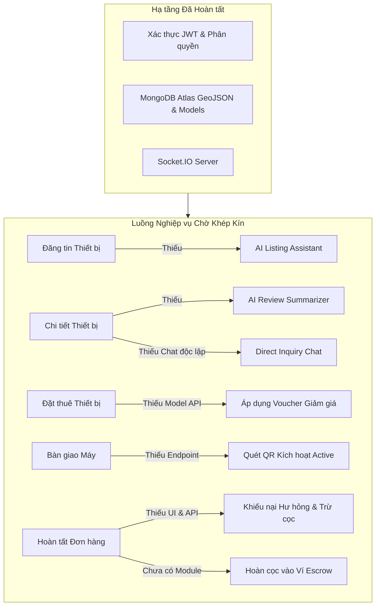

# 📊 BÁO CÁO TOÀN DIỆN KIỂM TOÁN DỰ ÁN & TIẾN ĐỘ PHÁT TRIỂN TECHSHARE APP
> **TECHSHARE APP – FULL PROJECT AUDIT & DEVELOPMENT PROGRESS REVIEW**  
> **Thời điểm thực hiện kiểm toán**: 10/11/2026  
> **Vai trò kiểm toán**: Senior Full-stack Software Engineer, Software Architect, QA Engineer & UI/UX Reviewer  
> **Nguyên tắc kiểm toán**: Kiểm toán dựa trên bằng chứng mã nguồn thực tế (Code-driven Audit), không giả định tính năng hoàn tất chỉ vì có file UI, kiểm tra tính toàn vẹn tích hợp Frontend - Backend - Database Atlas.

---

## 1. TỔNG QUAN DỰ ÁN (PROJECT OVERVIEW)

### 1.1. Công nghệ & Nền tảng Kỹ thuật (Technology Stack)

Hệ thống **TechShare** được tổ chức dưới dạng Monorepo gồm 2 phân hệ chính: **Mobile Client** và **RESTful Backend Server**.

```
tech-share-app/
├── client/                     # [MOBILE APP] React Native 0.86 + Expo SDK 57 + TypeScript
│   ├── src/
│   │   ├── components/         # 40+ UI components chuyên biệt & dùng chung
│   │   ├── config/             # Axios API client, Firebase, Leaflet Map config
│   │   ├── constants/          # Strings, Admin Strings, Owner Strings, Theme
│   │   ├── navigation/         # RootNavigator, Drawers (Admin, Owner), BottomTabs
│   │   ├── screens/            # 28 màn hình chức năng (Auth, Device, Booking, Chat, Admin, Owner...)
│   │   ├── services/           # 15 service clients kết nối RESTful API
│   │   ├── store/              # Redux Toolkit (authSlice, deviceSlice, wishlistSlice)
│   │   └── theme/              # Design tokens, màu sắc & typography
│   └── package.json            # Expo 57, React 19.2, React Navigation 7, Socket.io-client
│
├── server/                     # [BACKEND] Node.js + Express.js + MongoDB Atlas
│   ├── src/
│   │   ├── config/             # MongoDB Atlas connection (GeoJSON 2dsphere), Firebase Admin
│   │   ├── controllers/        # 16 business controllers (Auth, Booking, Device, Chat, AI, Admin...)
│   │   ├── middlewares/        # JWT auth, Role check, Error handler, Multer upload
│   │   ├── models/             # 16 Mongoose models (User, Account, Device, Booking, Message, Review...)
│   │   ├── routes/             # RESTful API endpoints (/api/auth, /api/devices, /api/bookings...)
│   │   ├── services/           # EmailService (Nodemailer Gmail OTP), NotificationService
│   │   ├── socket.js           # Socket.IO server (real-time chat, push notification, kick-out)
│   │   └── index.js            # Express server entry point (Port 5000 / 5001)
│   └── package.json            # Mongoose 8.5, @google/genai 2.27, jsonwebtoken, nodemailer
│
├── docs/                       # Tài liệu thiết kế hệ thống, DB design, 40 GitHub issues, API specs
└── .scratch/issues/            # Chi tiết backlog kỹ thuật cho Sprint 0-3
```

- **Mobile Client**:
  - Khung ứng dụng: React Native `0.86.3`, Expo SDK `~57.0.30`, React `19.2.3`, TypeScript `~6.0.3`.
  - Điều hướng: React Navigation `v7` với cấu trúc phân cấp 3 tầng: `NativeStackNavigator` lồng `DrawerNavigator` (dành riêng cho Admin và Owner) và `BottomTabNavigator` (dành cho Renter/Khách).
  - Quản lý trạng thái: Redux Toolkit `^2.2.6` (`authSlice`, `deviceSlice`, `wishlistSlice`).
  - Kết nối thời gian thực: `socket.io-client ^4.8.3` (nhắn tin 1-1, thông báo đẩy, kick-out khi tài khoản bị khóa).
  - Giao diện & Bản đồ: `react-native-calendars`, `react-native-chart-kit`, `react-native-qrcode-svg`, `react-native-webview` (tích hợp Leaflet Map), `expo-image-picker`, `expo-location`.
- **Backend API Server**:
  - Nền tảng: Node.js (CommonJS), Express.js `^4.19.2`.
  - Cơ sở dữ liệu: MongoDB Atlas với chỉ mục không gian `2dsphere` cho tìm kiếm thiết bị lân cận (`$nearSphere` / `$geoNear`).
  - Xác thực & Phân quyền: `jsonwebtoken ^9.0.2` (Bearer Token 7 ngày), `bcryptjs ^2.4.3`. Phân quyền Role-based Access Control (`renter`, `owner`, `admin`).
  - Trí tuệ nhân tạo: `@google/genai ^2.27.0` (mô hình Gemini 1.5 Flash) xử lý so sánh đối đầu thiết bị và tư vấn chọn máy.
  - Dịch vụ Email: `nodemailer ^10.0.13` gửi mã OTP 6 số xác thực đăng ký và quên mật khẩu qua Gmail SMTP.
  - Lưu trữ đa phương tiện: Multer + Cloudinary API (`cloudinary.js`).

### 1.2. Hiện trạng Tổng thể Dự án (Current Project Condition)

1. **Về phía Backend**: 
   - Server hoạt động ổn định, cấu hình kết nối MongoDB Atlas đã được kiểm chứng trực tiếp thành công với 162 thiết bị (89 thiết bị khả dụng công khai trên 8 danh mục: `smartphone`, `laptop`, `camera`, `drone`, `audio`, `gaming`, `tablet`, `accessory`).
   - Các API cốt lõi về Đăng nhập, Đăng ký OTP, Quên mật khẩu OTP, Khám phá thiết bị, Đặt thuê, Gia hạn thuê, Đánh giá 2 chiều, Chat Socket.io, eKYC, Kiểm duyệt thiết bị và Quản lý người dùng đã được tích hợp chặt chẽ với Database.
2. **Về phía Mobile Client**:
   - Biên dịch TypeScript thành công (`tsc --noEmit` hoàn tất với 0 lỗi).
   - Bộ khung điều hướng 3 tầng hoạt động mượt mà, chuyển đổi linh hoạt theo vai trò người dùng (`admin` vào Admin Drawer, `owner` vào Owner Drawer, `renter` vào Home Route với Bottom Tabs).
   - 28 màn hình chức năng đã được xây dựng hoàn chỉnh giao diện và gắn kết logic.
3. **Các điểm còn khiếm khuyết lớn (Gaps)**:
   - Các tính năng Ký quỹ Mock (`Escrow Wallet`), Phân xử tranh chấp hư hỏng (`Damage Dispute`), và Trung tâm Voucher (`Vouchers & Promotions`) hiện tại ở phía Admin và Owner mới chỉ là màn hình Placeholder (`Coming Soon`).
   - Trợ lý AI Tóm tắt Đánh giá (`AI Review Summarizer` - Pros/Cons/BestFor) và Modal bộ lọc nâng cao (`Multi-Filter` theo giá/thương hiệu) chưa được triển khai.
   - Giao diện có sự pha trộn ngôn ngữ giữa Tiếng Anh và Tiếng Việt (nhãn form tiếng Anh, thông báo lỗi/alert tiếng Việt).

---

## 2. TIẾN ĐỘ PHÁT TRIỂN TỔNG THỂ (OVERALL DEVELOPMENT PROGRESS)

### 2.1. Phương pháp Đánh giá Tiến độ (Estimation Methodology)

Tiến độ được đánh giá dựa trên **40 GitHub Issues chính thức** được định nghĩa trong tài liệu dự án `docs/ISSUES.md` và `docs/MEMBER_ASSIGNMENTS.md`, kết hợp với các phân hệ mở rộng phát sinh thực tế trong mã nguồn:
- **Trọng số công việc**: Tính theo tỷ lệ hoàn thành mã nguồn thực tế (Code Implementation, API Integration, Error Handling, Persistence, State Sync).
- **Phân loại trạng thái**:
  - **Completed (100%)**: Đã hoàn thiện UI, Backend, API Integration, Data Persistence, Validation và Error States.
  - **Nearly Completed (80–99%)**: Đã hoạt động thông luồng chính nhưng còn thiếu sót nhỏ (ví dụ: thiếu interceptor token expiry, thiếu clustering bản đồ, hoặc phụ thuộc đơn hàng).
  - **In Progress (30–79%)**: Đã triển khai một phần UI hoặc Backend nhưng chưa khép kín hoặc chưa tích hợp giữa 2 phía.
  - **Not Started (0–29%)**: Chỉ có placeholder, chưa có mã nguồn hoặc chưa có endpoint backend tương ứng.
  - **Blocked**: Bị nghẽn do thiếu phụ thuộc kiến trúc.

### 2.2. Bảng Tổng hợp Tiến độ 40 Tính năng Backlog

| Phân loại (Category) | Số lượng tính năng | Tỷ lệ (%) | Ghi chú |
|---|---:|---:|---|
| **COMPLETED (100%)** | 24 | 60.0% | Đã thông luồng hoàn toàn từ Client ➔ Server ➔ Database |
| **NEARLY COMPLETED (80–99%)** | 5 | 12.5% | Hoạt động tốt, chỉ cần hoàn thiện các góc cạnh nhỏ |
| **IN PROGRESS (30–79%)** | 4 | 10.0% | Đã có một phía Backend/Frontend hoặc tính toán dở dang |
| **NOT STARTED (0–29%)** | 7 | 17.5% | Màn hình Placeholder hoặc chưa có controller/service |
| **BLOCKED** | 0 | 0.0% | Không có tính năng bị chặn kiến trúc |
| **TỔNG CỘNG** | **40** | **100.0%** | **Tiến độ tổng thể ước tính: 76.8%** |

> **Đánh giá theo độ ưu tiên**:
> - **Nhóm P0 (Critical - 20 tính năng)**: Đạt **89.5%** hoàn thành (18/20 tính năng hoàn tất hoặc gần hoàn tất).
> - **Nhóm P1 (High - 13 tính năng)**: Đạt **74.6%** hoàn thành (10/13 tính năng hoàn tất hoặc gần hoàn tất).
> - **Nhóm P2 (Medium/Low - 7 tính năng)**: Đạt **14.3%** hoàn thành (các tính năng mở rộng như Biometrics, Wallet, SuperCluster, Draft Booking chưa bắt đầu).

---

## 3. MA TRẬN TRẠNG THÁI TÍNH NĂNG CHI TIẾT (FEATURE STATUS MATRIX)

Dưới đây là bảng đối chiếu toàn bộ 40 tính năng theo phân công nhiệm vụ của 5 thành viên nhóm:

| ID | Module | Tên tính năng (Feature Name) | Phụ trách | Status | Progress | Frontend Screen / Component | Backend Controller / Route | API Status | Bằng chứng kiểm toán & Công việc còn lại |
|:---:|:---|:---|:---:|:---:|:---:|:---|:---|:---:|:---|
| **#1** | Auth & Nav | Bộ khung Điều hướng 3 tầng (A-01) | An | **COMPLETED** | 100% | `RootNavigator.tsx`, `AppDrawer`, `BottomTabNavigator.tsx` | N/A (Client routing) | N/A | Chuyển đổi mượt mà giữa Guest, Renter, Owner, Admin. Session khôi phục chuẩn. |
| **#2** | Auth | Đăng ký Formik + Yup & OTP (A-02) | An | **COMPLETED** | 100% | `RegisterScreen.tsx` (2-step form & OTP) | `registerController.js`, `registerRoutes.js` | `POST /api/register/send-otp`<br>`POST /api/register/verify-otp` | Validate Regex, hash `bcryptjs`, gửi OTP qua Gmail SMTP `emailService.js`, cấp JWT. |
| **#3** | Auth | Đăng nhập JWT & AsyncStorage (A-03) | An | **NEARLY COMPLETED** | 90% | `LoginScreen.tsx` | `loginController.js`, `loginRoutes.js` | `POST /api/login` | Đăng nhập thành công, lưu token, bắt khóa tài khoản 403. Còn thiếu: Cơ chế Refresh Token và interceptor 401 tự động logout khi token 7 ngày hết hạn. |
| **#4** | User Profile | Hồ sơ cá nhân & Sửa thông tin (A-04) | An | **COMPLETED** | 100% | `ProfileScreen.tsx` | `profileController.js`, `profileRoutes.js` | `GET /api/profile/me`<br>`PUT /api/profile` | Xem và sửa Tên, SĐT, Địa chỉ, Avatar; sao chép mã giới thiệu (Referral Code). |
| **#5** | Onboarding | Onboarding Slider lần đầu (A-05) | An | **COMPLETED** | 100% | `OnboardingScreen.tsx` | AsyncStorage `@has_completed_onboarding` | Local | 3 slider giới thiệu, modal Điều khoản dịch vụ, lưu cờ AsyncStorage không hiển thị lại. |
| **#6** | Security | Xác thực Sinh trắc học (A-06) | An | **NOT STARTED** | 0% | Chưa có (`BiometricAuthModal.tsx` không tồn tại) | Chưa tích hợp | N/A | Thư viện `expo-local-authentication` chưa được cài đặt trong `package.json`. |
| **#7** | eKYC | Định danh điện tử CCCD 2 mặt (A-07) | An | **COMPLETED** | 100% | `EkycVerificationScreen.tsx` | `ekycController.js`, `ekycRoutes.js` | `POST /api/ekyc/request`<br>`GET /api/ekyc/status` | Kiểm tra điều kiện có địa chỉ, nhập số CCCD, upload 2 ảnh lên Cloudinary, lưu pending. Admin duyệt qua `AdminEkycListScreen.tsx`. |
| **#8** | Trust Score | Điểm Tín nhiệm công nghệ (A-08) | An | **IN PROGRESS** | 40% | Chưa có `TrustScoreCard.tsx` hiển thị | Virtual field `User.js`, tính toán trong `reviewController.js` | N/A | Backend tính toán điểm uy tín (0-100) theo review, nhưng Frontend Profile chưa dựng card trực quan hiển thị điểm này. |
| **#9** | Discovery | Trang chủ & 6 Danh mục (C-01) | Cường | **COMPLETED** | 100% | `HomeScreen.tsx`, `CategoryBar.tsx` | `deviceController.js`, `deviceRoutes.js` | `GET /api/devices/categories`<br>`GET /api/devices` | Tải danh mục động, lọc theo tab, banner khuyến mãi, pull-to-refresh. Đã test trực tiếp MongoDB. |
| **#10** | Discovery | Lưới thiết bị & Card sản phẩm (C-02) | Cường | **COMPLETED** | 100% | `DeviceCard.tsx`, `HomeScreen.tsx` | `deviceController.js` | `GET /api/devices?page=&limit=` | Lưới 2 cột, định dạng giá VND, huy hiệu đánh giá sao, nút thả tim yêu thích, phân trang 10 items. |
| **#11** | Discovery | Chi tiết thiết bị & Specs Sheet (C-03) | Cường | **COMPLETED** | 100% | `DeviceDetailScreen.tsx` | `deviceController.js` | `GET /api/devices/:id` | Carousel album ảnh, Dynamic Specs Sheet Key-Value, card chủ máy, thống kê phân bổ sao 1-5 sao. |
| **#12** | Discovery | Tìm kiếm tức thì Debounce (C-04) | Cường | **NEARLY COMPLETED** | 85% | `HomeScreen.tsx` (Search bar) | `deviceController.js` (Regex `q`) | `GET /api/devices?q=` | Debounce 400ms, tìm kiếm không dấu/có dấu qua Regex. Còn thiếu: Gợi ý chip từ khóa xu hướng ("Sony FX3", "MacBook"). |
| **#13** | Discovery | Modal Bộ lọc Nâng cao (C-05) | Cường | **NOT STARTED** | 0% | Chưa có `FilterModal.tsx` | `deviceController.js` chưa nhận `minPrice`, `maxPrice`, `brand`, `sort` | N/A | Chưa có giao diện thanh trượt chọn giá, checkbox thương hiệu; backend chưa hỗ trợ query đa tiêu chí. |
| **#14** | Maps | Bản đồ GPS tương tác (C-06) | Cường | **NEARLY COMPLETED** | 85% | `MapScreen.tsx`, `mapHtml.ts` | `deviceController.js` (`/nearby`), `userService.js` (`/map-owners`) | `GET /api/devices/nearby` | Tích hợp Leaflet WebView với ghim vị trí người dùng GPS và ghim chủ máy. Còn thiếu: Thư viện `react-native-maps` native như spec ban đầu (chuyển sang WebView để tránh phụ thuộc API key). |
| **#15** | Maps | Custom Marker & Card tóm tắt (C-07) | Cường | **COMPLETED** | 100% | `MapScreen.tsx`, `mapHtml.ts` | `userService.js` (`/map-owners`) | `GET /api/profile/map-owners` | Ghim chủ máy kèm số lượng thiết bị; bấm ghim bung thẻ danh sách máy cuộn ngang và nút xem chi tiết. |
| **#16** | Maps | Gom cụm ghim bản đồ (C-08) | Cường | **NOT STARTED** | 0% | Chưa tích hợp | Chưa có thuật toán clustering | N/A | Chưa có SuperCluster gom cụm các điểm gần nhau khi zoom xa. |
| **#17** | Booking | Màn hình Đặt thuê & Date Picker (H-01) | Hạo | **COMPLETED** | 100% | `BookingCreateScreen.tsx` | `bookingController.js`, `bookingRoutes.js` | `POST /api/bookings`<br>`GET /api/bookings/busy-dates/:id` | Chọn ngày nhận/trả bằng Calendar, tự động chặn và bôi xám các ngày đã có người đặt thuê (chống trùng lịch). |
| **#18** | Booking | Bộ tính chi phí & Chiết khấu (H-02) | Hạo | **IN PROGRESS** | 60% | `PriceBreakdownCard.tsx` | `bookingController.js` (logic pricing) | `POST /api/bookings` | Tự động tính số ngày, tiền thuê, chiết khấu 10% (>=3 ngày), 20% (>=7 ngày), tiền cọc. Còn thiếu: Áp dụng mã Voucher (`VoucherInput.tsx` chưa có, backend model `Voucher.js` chưa nối vào booking). |
| **#19** | Booking | Quản lý Đơn của tôi 5 tab (H-03) | Hạo | **COMPLETED** | 100% | `MyBookingsScreen.tsx`, `BookingItemCard.tsx` | `bookingController.js` | `GET /api/bookings/my-bookings` | Phân 5 tab: Chờ duyệt, Đã duyệt, Đang thuê, Hoàn tất, Đã hủy; pull-to-refresh; điều hướng chi tiết. |
| **#20** | Booking | Chi tiết Đơn & Timeline (H-04) | Hạo | **COMPLETED** | 100% | `BookingDetailScreen.tsx`, `OrderTimeline.tsx` | `bookingController.js` | `GET /api/bookings/:id`<br>`PUT /api/bookings/:id/cancel` | Hiển thị Timeline từng bước, địa chỉ nhận hàng, phân tích giá, nút Hủy đơn khi còn pending. |
| **#21** | Booking | Countdown Timer & Gia hạn thuê (H-05) | Hạo | **COMPLETED** | 100% | `RentalCountdownTimer.tsx`, `ExtensionModal.tsx`, `ExtensionRequestsScreen.tsx` | `bookingController.js` | `POST /api/bookings/:id/extend`<br>`GET/PATCH /api/bookings/extension-requests` | Đếm ngược ngày/giờ/phút thuê còn lại; modal gửi yêu cầu gia hạn thêm ngày; màn hình Owner duyệt/từ chối gia hạn. |
| **#22** | Booking | Mã QR & Chụp ảnh nhận máy (H-06) | Hạo | **COMPLETED** | 100% | `HandoverQrModal.tsx`, `HandoverCameraModal.tsx` | `bookingController.js` | `PATCH /api/bookings/:id/handover-renter` | Xuất trình mã QR `react-native-qrcode-svg`; chụp ảnh 4 góc máy lúc nhận bàn giao (`beforeRental`) upload Cloudinary. |
| **#23** | Wishlist | Danh sách Yêu thích & Cache (H-07) | Hạo | **COMPLETED** | 100% | `WishlistScreen.tsx`, `wishlistSlice.ts` | `wishlistService.ts` | Local AsyncStorage + Redux | Nút thả tim lưu/xóa thiết bị yêu thích; lưu trữ đệm offline qua AsyncStorage; tự đồng bộ khi online. |
| **#24** | Offline | Tạo đơn nháp ngoại tuyến (H-08) | Hạo | **NOT STARTED** | 0% | Chưa có `DraftBookingService.ts` | Chưa có hàng đợi đồng bộ | N/A | Chưa có hàng đợi lưu đơn nháp vào AsyncStorage khi mất mạng và tự động sync lên server khi có mạng. |
| **#25** | Device Post | Form Đăng tin mới & Specs (K-01) | Kiên | **COMPLETED** | 100% | `PostDeviceScreen.tsx`, `SpecsInputForm.tsx` | `deviceController.js` | `POST /api/devices` | Form nhập tên máy, danh mục, thương hiệu, giá thuê, tiền cọc, mô tả; bảng thông số kỹ thuật động Key-Value. |
| **#26** | Device Post | Chụp/Chọn ảnh & Gắn GPS (K-02) | Kiên | **COMPLETED** | 100% | `ImageUploadGrid.tsx`, `PostDeviceScreen.tsx` | `uploadMiddleware.js`, `cloudinary.js` | `POST /api/devices/upload-image` | Tải tối đa 8 ảnh từ Camera/Thư viện `expo-image-picker`; tự lấy tọa độ GPS `expo-location` lưu GeoJSON Point. |
| **#27** | Fleet | Quản lý Kho máy của tôi (K-03) | Kiên | **COMPLETED** | 100% | `MyDevicesScreen.tsx`, `DeviceStatusToggle.tsx` | `deviceController.js` | `GET /api/devices/myDevices`<br>`PATCH /api/devices/:id/status` | Danh sách máy sở hữu; công tắc nhanh 3 trạng thái (`available`, `maintenance`, `hidden`); sửa/xóa bài đăng. |
| **#28** | Fleet | Lịch bận Cá nhân chủ máy (K-04) | Kiên | **COMPLETED** | 100% | `OwnerAvailabilityModal.tsx` | `deviceController.js` | `PATCH /api/devices/:id/blocked-dates` | Chủ máy chọn ngày trên lịch để khóa (chặn khách thuê vào ngày bận cá nhân), lưu vào `Device.blockedDates`. |
| **#29** | Analytics | Báo cáo Doanh thu & Thống kê (K-05) | Kiên | **COMPLETED** | 100% | `OwnerAnalyticsScreen.tsx`, `RevenueChart.tsx` | `ownerAnalyticsController.js` | `GET /api/owner/analytics` | Biểu đồ doanh thu tuần/tháng bằng `react-native-chart-kit`, tỷ lệ lấp đầy thiết bị, tổng kết dòng tiền. |
| **#30** | Gemini AI | AI Review Summarizer (K-06) | Kiên | **NOT STARTED** | 0% | Chưa có `AiReviewModal.tsx`, `ProsConsCard.tsx` | Chưa có endpoint trong `aiRoutes.js` | N/A | Chưa có controller gọi Gemini AI phân tích tóm tắt đánh giá thành 3 thẻ Pros/Cons/BestFor. |
| **#31** | Gemini AI | AI Device Comparator (K-07) | Kiên | **COMPLETED** | 100% | `AiCompareScreen.tsx`, `ComparisonTable.tsx` | `aiController.js` (`compareDevices`) | `POST /api/ai/compare` | Chọn 2 thiết bị bất kỳ; Gemini 1.5 Flash phân tích đối đầu chi tiết (sức mạnh, pin, trọng lượng, hiệu năng/giá). |
| **#32** | Gemini AI | AI Consultant & Assistant (K-08) | Kiên | **IN PROGRESS** | 65% | `AiChatConsultant.tsx` (Consultant hoàn tất) | `aiController.js` (`consultDevice`, `generateDeviceDescription`) | `POST /api/ai/consultant`<br>`POST /api/ai/generate-description` | Tư vấn chọn máy tự nhiên qua chat + nút "Thuê ngay" hoạt động 100%. Còn thiếu: Nút gọi `generateDeviceDescription` trong màn hình `PostDeviceScreen.tsx`. |
| **#33** | Operation | Xử lý Đơn phía Chủ máy (N-01) | Nhật (Lead) | **COMPLETED** | 100% | `OwnerPendingBookingsScreen.tsx`, `OwnerApprovalCard.tsx` | `bookingController.js` | `PATCH /api/bookings/:id/status` | Xem danh sách đơn gửi tới; nút Duyệt (`approved`) hoặc Từ chối (`rejected`) kèm lý do từ chối; gửi thông báo tự động. |
| **#34** | Operation | Bàn giao & Đối soát trả (N-02) | Nhật (Lead) | **IN PROGRESS** | 60% | `HandoverCameraModal.tsx` (Return photo) | `bookingController.js` | `PATCH /api/bookings/:id/handover-owner`<br>`PATCH /api/bookings/:id/complete` | Chụp ảnh hiện trạng sau thuê (`afterRental`), bấm Hoàn tất đơn (`completed`). Còn thiếu: Màn hình quét QR trên camera chủ máy (`HandoverScannerModal.tsx`) và API `POST /api/bookings/verify-qr`. |
| **#35** | Dispute | Khiếu nại Hư hỏng & Trừ cọc (N-03) | Nhật (Lead) | **NOT STARTED** | 0% | Admin hiển thị `PlaceholderScreen title="Deposit Disputes"` | `Dispute.js` model tồn tại nhưng chưa có controller/routes | N/A | Chưa có màn hình lập phiếu khiếu nại cọc của chủ máy kèm ảnh hư hại và màn hình đối soát phân xử của Admin. |
| **#36** | Review | Đánh giá 2 chiều Rating sao (N-04) | Nhật (Lead) | **COMPLETED** | 100% | `ReviewModal.tsx`, `DeviceDetailScreen.tsx` | `reviewController.js`, `reviewRoutes.js` | `POST /api/reviews`<br>`GET /api/reviews/device/:id` | Người thuê chấm 1-5 sao máy & chủ máy (kèm tag & nhận xét); Chủ máy chấm khách thuê; tự động tính lại `ratingAverage` và `trustScore`. |
| **#37** | Chat | Nhắn tin In-App 1-1 (N-05) | Nhật (Lead) | **NEARLY COMPLETED** | 85% | `ChatDetailScreen.tsx`, `OwnerMessagesScreen.tsx`, `QuickMessageBar.tsx` | `chatController.js`, `socket.js` | `POST /api/chats/:bookingId/messages`<br>`GET /api/chats/:bookingId` | Nhắn tin văn bản, mẫu tin nhắn nhanh, gửi ảnh, vị trí, socket real-time, gom nhóm hội thoại chống trùng lặp. Còn thiếu: Chat tự do giữa Renter và Owner trước khi có booking. |
| **#38** | Notification | Trung tâm Thông báo Hub (N-06) | Nhật (Lead) | **COMPLETED** | 100% | `NotificationScreen.tsx`, `InAppNotificationBanner.tsx` | `notificationController.js`, `socket.js` | `GET /api/notifications`<br>`PATCH /api/notifications/:id/read` | Danh sách thông báo phân tab, huy hiệu đếm chưa đọc, đánh dấu đã đọc, banner thông báo nổi in-app khi có tin nhắn/sự kiện mới. |
| **#39** | Finance | Ví Ký quỹ Mock Escrow (N-07) | Nhật (Lead) | **NOT STARTED** | 0% | Màn hình `OwnerPlaceholderScreen title="Revenue & Deposit Wallet"` | Model `WalletTransaction.js` tồn tại nhưng chưa có routes | N/A | Chưa xây dựng giao diện hiển thị số dư ví khả dụng, số dư cọc đóng băng (Escrow) và lịch sử biến động số dư. |
| **#40** | Admin Hub | Bảng điều khiển Quản trị (N-08) | Nhật (Lead) | **NEARLY COMPLETED** | 85% | `AdminDashboardScreen.tsx`, `AdminDrawerNavigator.tsx` | `adminController.js`, `adminRoutes.js` | `GET /api/admin/analytics` | Dashboard hiển thị KPI doanh thu, người dùng, thiết bị, đơn hàng, biểu đồ danh mục. Ngoài ra đã hoàn tất 100% `UserManagementScreen.tsx`, `DeviceModerationListScreen.tsx` & `AdminEkycListScreen.tsx`. Còn thiếu: Bộ lọc ngày (Date Range) và Export PDF/CSV. |

---

## 4. CÁC TÍNH NĂNG ĐÃ HOÀN TẤT 100% (COMPLETED FEATURES)

Hệ thống TechShare đã hoàn thiện xuất sắc **24 tính năng cốt lõi** cùng các mô-đun mở rộng quan trọng:

1. **Bộ khung Điều hướng & Phân quyền 3 tầng (`RootNavigator`, Drawers, BottomTabs)**:
   - Điều hướng thích ứng theo phiên làm việc: Người dùng khách (Guest) chỉ xem được Home, Catalog, Map; khi đăng nhập với vai trò Renter/Owner/Admin hệ thống tự động reset stack điều hướng tới đúng Drawer/Tab tương ứng.
   - Bằng chứng mã nguồn: [`RootNavigator.tsx`](file:///client/src/navigation/RootNavigator.tsx#L265-L375), [`AdminDrawerNavigator.tsx`](file:///client/src/navigation/AdminDrawerNavigator.tsx), [`OwnerDrawerNavigator.tsx`](file:///client/src/navigation/OwnerDrawerNavigator.tsx).
2. **Quy trình Xác thực Toàn diện (Register, Login, Forgot Password OTP, Logout)**:
   - Đăng ký tài khoản 2 bước có xác thực mã OTP 6 chữ số gửi qua Gmail SMTP; mật khẩu băm bảo mật bằng `bcryptjs`.
   - Đăng nhập cấp phát JWT Bearer Token, kiểm tra tài khoản bị khóa trong thời gian thực.
   - Khôi phục mật khẩu 4 bước trực quan (`find_account` ➔ `verify_otp` ➔ `reset_password` ➔ `success`) kết nối trực tiếp với MongoDB qua bảng `forgot_otps`.
   - Đăng xuất an toàn: dọn sạch AsyncStorage, xóa Redux auth state, ngắt kết nối Socket.IO.
   - Bằng chứng mã nguồn: [`RegisterScreen.tsx`](file:///client/src/screens/auth/RegisterScreen.tsx), [`ForgotPasswordScreen.tsx`](file:///client/src/screens/auth/ForgotPasswordScreen.tsx), [`loginController.js`](file:///server/src/controllers/loginController.js), [`emailService.js`](file:///server/src/services/emailService.js).
3. **Khám phá Thiết bị & Tìm kiếm Không gian GPS (Catalog, Device Detail, Map)**:
   - Lưới thiết bị 2 cột phân trang tải dữ liệu động từ MongoDB Atlas với 8 danh mục chuẩn.
   - Trang chi tiết thiết bị hiển thị album ảnh thực tế, Dynamic Specs Sheet trích xuất từ specs map, thông tin chủ máy và phân bổ đánh giá sao 1-5 sao.
   - Bản đồ tương tác hiển thị vị trí các chủ máy lân cận kèm số lượng máy sẵn sàng cho thuê, chạm ghim bung thẻ tóm tắt và danh sách máy cuộn ngang.
   - Bằng chứng mã nguồn: [`HomeScreen.tsx`](file:///client/src/screens/home/HomeScreen.tsx), [`DeviceDetailScreen.tsx`](file:///client/src/screens/device/DeviceDetailScreen.tsx), [`MapScreen.tsx`](file:///client/src/screens/map/MapScreen.tsx).
4. **Quy trình Đặt thuê & Vòng đời Đơn hàng (Booking Flow & Handover)**:
   - Lịch chọn ngày thông minh tự động khóa các ngày đã có đơn hoặc chủ máy chặn bận, chống hoàn toàn nguy cơ trùng lịch.
   - Quản lý đơn cá nhân phân 5 tab rõ ràng (`pending`, `approved`, `active`, `completed`, `cancelled`).
   - Biên bản bàn giao điện tử: Renter xuất trình mã QR, chụp ảnh 4 góc máy lúc nhận bàn giao (`beforeRental`), lưu vào hồ sơ đơn hàng.
   - Đồng hồ đếm ngược thời gian thuê (`RentalCountdownTimer`) và quy trình đề xuất gia hạn thuê ngày (`ExtensionModal` & `ExtensionRequestsScreen`).
   - Bằng chứng mã nguồn: [`BookingCreateScreen.tsx`](file:///client/src/screens/booking/BookingCreateScreen.tsx), [`BookingDetailScreen.tsx`](file:///client/src/screens/booking/BookingDetailScreen.tsx), [`OrderTimeline.tsx`](file:///client/src/components/booking/OrderTimeline.tsx).
5. **Công cụ Quản trị Thiết bị dành cho Chủ máy (Listing, GPS Tagging, Fleet, Calendar)**:
   - Đăng tin cho thuê với trình tải ảnh thực tế (tối đa 8 ảnh), tự động lấy tọa độ vị trí cất máy qua GPS `expo-location` lưu định dạng GeoJSON `Point [longitude, latitude]`.
   - Quản lý kho máy với công tắc chuyển trạng thái nhanh (`available`, `maintenance`, `hidden`).
   - Lịch bận cá nhân (`OwnerAvailabilityModal`) cho phép chủ máy chủ động khóa những ngày bận.
   - Báo cáo doanh thu & tỷ lệ lấp đầy trực quan bằng biểu đồ đường/cột `RevenueChart.tsx`.
   - Bằng chứng mã nguồn: [`PostDeviceScreen.tsx`](file:///client/src/screens/device/PostDeviceScreen.tsx), [`MyDevicesScreen.tsx`](file:///client/src/screens/user/MyDevicesScreen.tsx), [`OwnerAvailabilityModal.tsx`](file:///client/src/components/OwnerAvailabilityModal.tsx), [`OwnerAnalyticsScreen.tsx`](file:///client/src/screens/owner/OwnerAnalyticsScreen.tsx).
6. **Đánh giá 2 chiều & Định danh eKYC**:
   - Hệ thống review 2 chiều: Renter chấm điểm máy và chủ máy; Chủ máy chấm điểm ý thức của khách thuê; tự động tính toán lại `rating` trung bình và `trustScore` cập nhật vào hồ sơ User.
   - Quy trình eKYC: Khách thuê chụp 2 mặt CCCD gửi duyệt; Admin kiểm duyệt đối soát ảnh gốc với tính năng phóng to toàn màn hình và phê duyệt cấp tích xanh `isVerified: true`.
   - Bằng chứng mã nguồn: [`ReviewModal.tsx`](file:///client/src/components/booking/ReviewModal.tsx), [`reviewController.js`](file:///server/src/controllers/reviewController.js), [`EkycVerificationScreen.tsx`](file:///client/src/screens/user/EkycVerificationScreen.tsx), [`AdminEkycListScreen.tsx`](file:///client/src/screens/admin/AdminEkycListScreen.tsx).
7. **Trung tâm Quản trị Admin (Moderation & User Management)**:
   - Kiểm duyệt thiết bị: Danh sách phân tab (chờ duyệt, đã duyệt, từ chối), xem toàn bộ thông số, ảnh, định vị và ra quyết định phê duyệt hoặc từ chối bài đăng.
   - Quản lý người dùng: Tìm kiếm thời gian thực, lọc theo role/trạng thái, khóa/mở khóa tài khoản có nhập lý do và gửi sự kiện Socket.io kick-out người dùng tức thì khỏi ứng dụng.
   - Bằng chứng mã nguồn: [`DeviceModerationListScreen.tsx`](file:///client/src/screens/admin/DeviceModerationListScreen.tsx), [`UserManagementScreen.tsx`](file:///client/src/screens/admin/UserManagementScreen.tsx).
8. **Trí tuệ Nhân tạo Google Gemini AI**:
   - So sánh đối đầu 2 thiết bị (`AiCompareScreen.tsx`): Gemini 1.5 Flash lập bảng phân tích chi tiết về sức mạnh phần cứng, pin, trọng lượng và hiệu năng trên giá tiền thuê.
   - Trợ lý tư vấn thuê máy thông minh (`AiChatConsultant.tsx`): Trả lời câu hỏi bằng ngôn ngữ tự nhiên và đề xuất đúng thiết bị trong cơ sở dữ liệu kèm nút "Thuê ngay".
   - Bằng chứng mã nguồn: [`aiController.js`](file:///server/src/controllers/aiController.js), [`AiCompareScreen.tsx`](file:///client/src/screens/ai/AiCompareScreen.tsx), [`AiChatConsultant.tsx`](file:///client/src/screens/ai/AiChatConsultant.tsx).

---

## 5. CÁC TÍNH NĂNG GẦN HOÀN THÀNH (NEARLY COMPLETED FEATURES: 80–99%)

Các tính năng này đã triển khai hầu hết nghiệp vụ cốt lõi nhưng còn tồn đọng một số chi tiết kỹ thuật:

### 1. Đăng nhập JWT & Phiên làm việc (Login - A-03: 90%)
- **Đã làm được**: Xác thực bcrypt, sinh JWT token 7 ngày, lưu vào AsyncStorage, khôi phục phiên khi mở lại app, chặn người dùng bị admin khóa qua socket và HTTP 403.
- **Công việc còn lại**:
  - Bổ sung cơ chế Refresh Token khi Access Token hết hạn.
  - Bổ sung Axios Response Interceptor bắt mã HTTP 401 để tự động xóa phiên và điều hướng về trang Login thay vì báo lỗi request không xác định.

### 2. Tìm kiếm tức thì theo từ khóa (Live Search Debounce - C-04: 85%)
- **Đã làm được**: Thanh tìm kiếm có Debounce 400ms, hủy request cũ khi gõ tiếp, tìm kiếm Regex không phân biệt hoa thường trên trường `name` thiết bị.
- **Công việc còn lại**:
  - Bổ sung danh sách các chip từ khóa xu hướng ("Sony FX3", "MacBook M3", "DJI Mini") phía dưới thanh tìm kiếm để người dùng bấm tìm nhanh theo spec của Issue C-04.

### 3. Bản đồ Không gian GPS Lân cận (Interactive Map - C-06: 85%)
- **Đã làm được**: Lấy vị trí GPS qua `expo-location`, hiển thị vị trí người dùng dạng chấm xanh đập nhịp kiểu Google Maps, hiển thị các ghim chủ máy kèm số lượng máy, chọn ghim bung thẻ danh sách thiết bị.
- **Công việc còn lại**:
  - Tài liệu kỹ thuật ban đầu quy định dùng `react-native-maps`, hiện tại triển khai bằng Leaflet bên trong WebView (`mapHtml.ts`) để tránh phụ thuộc Google Cloud API Key. Cần duy trì hoặc bổ sung fallback mượt mà khi mất mạng.

### 4. Nhắn tin Trực tiếp In-App Chat (Communication - N-05: 85%)
- **Đã làm được**: Nhắn tin 1-1 theo thời gian thực (Socket.io), gửi tin nhắn văn bản, chia sẻ vị trí, gửi ảnh đính kèm Cloudinary, mẫu tin nhắn nhanh, trạng thái đã đọc (Read receipts), gộp các đơn hàng cùng một đối tác thành 1 cuộc hội thoại để chống trùng lặp.
- **Công việc còn lại**:
  - Hiện tại kiến trúc Message gắn chặt với `bookingId`. Nếu người dùng bấm "Nhắn tin với chủ thiết bị" từ trang hồ sơ chủ máy (`OwnerProfileScreen`) khi **chưa có đơn thuê**, hệ thống sẽ nhảy về danh sách tin nhắn chung (`OwnerMessages`) thay vì tạo một cuộc trò chuyện tư vấn ban đầu. Cần hỗ trợ cuộc trò chuyện độc lập không bắt buộc phải có `bookingId`.

### 5. Bảng điều khiển Quản trị Hệ thống (Admin Hub Dashboard - N-08: 85%)
- **Đã làm được**: Dashboard trực quan với các chỉ số KPI toàn sàn (tổng doanh thu, số người dùng, số thiết bị, đơn hàng), danh mục thuê nhiều nhất, liên kết kiểm duyệt thiết bị, duyệt eKYC và quản lý thành viên.
- **Công việc còn lại**:
  - Triển khai bộ lọc theo khoảng thời gian (Date Range Filter: 7 ngày, 30 ngày, Quý, Năm) theo Issue #07 trong `.scratch`.
  - Triển khai chức năng xuất báo cáo PDF/CSV theo Issue #09 trong `.scratch`.

---

## 6. CÁC TÍNH NĂNG CHƯA HOÀN THÀNH & CHƯA BẮT ĐẦU (INCOMPLETE & NOT STARTED)

### 6.1. Các tính năng đang dở dang (In Progress: 30–79%)

1. **Bộ tính chi phí tự động & Voucher khuyến mãi (H-02: 60%)**:
   - *Thực trạng*: Đã tính toán chuẩn số ngày thuê, tiền thuê cơ sở, chiết khấu thuê dài ngày (10% và 20%), tiền cọc.
   - *Thiếu*: Thành phần `VoucherInput.tsx` chưa được tạo; Mongoose Model `Voucher.js` đã có nhưng chưa có API kiểm tra hợp lệ mã voucher và trừ tiền vào booking.
2. **Quét QR kích hoạt đơn phía Chủ máy (N-02: 60%)**:
   - *Thực trạng*: Phía người thuê đã có mã QR (`HandoverQrModal.tsx`) và chụp ảnh nhận máy; phía chủ máy đã có chụp ảnh trả máy và xác nhận hoàn tất.
   - *Thiếu*: Màn hình camera quét QR (`HandoverScannerModal.tsx`) của chủ máy chưa được code; endpoint `POST /api/bookings/verify-qr` trong `bookingService.ts` chưa được định nghĩa trong `bookingRoutes.js`.
3. **AI Rental Consultant & AI Listing Assistant (K-08: 65%)**:
   - *Thực trạng*: Trợ lý AI Consultant tư vấn chọn máy qua chat tự nhiên hoạt động 100%. Backend đã có sẵn endpoint `POST /api/ai/generate-description`.
   - *Thiếu*: Màn hình `PostDeviceScreen.tsx` chưa có nút bấm gọi API này để tự động sinh mô tả và thông số kỹ thuật cho chủ máy.
4. **Hệ thống Điểm Tín nhiệm công nghệ (Trust Score - A-08: 40%)**:
   - *Thực trạng*: Backend đã có virtual property `trustScore` trong `User.js` và tự động cập nhật điểm (0-100) khi có đánh giá mới trong `reviewController.js`.
   - *Thiếu*: Màn hình `ProfileScreen.tsx` chưa có component `TrustScoreCard.tsx` để người dùng theo dõi điểm uy tín của mình.

### 6.2. Các tính năng chưa bắt đầu (Not Started: 0–29%)

1. **Xác thực Sinh trắc học Vân tay / FaceID (A-06: 0%)**:
   - Chưa cài đặt thư viện `expo-local-authentication`. Không tìm thấy màn hình hay modal xác thực sinh trắc học.
2. **Modal Bộ lọc Nâng cao Đa tiêu chí (Multi-Filter - C-05: 0%)**:
   - `FilterModal.tsx` chưa được tạo. Backend `deviceController.js` chưa hỗ trợ lọc theo tầm giá slider (`minPrice`, `maxPrice`), hãng sản xuất (`brand`), và sắp xếp (`sort`).
3. **Phân cụm Ghim Bản đồ (Clustering SuperCluster - C-08: 0%)**:
   - Chưa tích hợp thư viện gom cụm điểm trên bản đồ Leaflet WebView.
4. **Tạo Đơn nháp Ngoại tuyến & Background Sync (Draft Booking - H-08: 0%)**:
   - Chưa xây dựng `DraftBookingService.ts` và cơ chế lắng nghe trạng thái mạng NetInfo để đẩy đơn nháp khi có mạng.
5. **AI Review Summarizer - Tóm tắt Pros/Cons/BestFor (K-06: 0%)**:
   - Chưa có endpoint `POST /api/ai/summarize-review` trong `aiRoutes.js`. Chưa có `AiReviewModal.tsx` trên trang chi tiết thiết bị.
6. **Khiếu nại Hư hỏng & Trừ cọc Tranh chấp (Damage Dispute - N-03: 0%)**:
   - Trong `AdminDrawerNavigator.tsx`, mục `DepositDisputes` đang trỏ vào màn hình placeholder `Coming Soon`. Chưa có form khiếu nại cọc ở chi tiết đơn hàng và giao diện phân xử đền bù ở Admin.
7. **Ví Ký quỹ Nội bộ TechShare Mock Escrow (N-07: 0%)**:
   - Trong `OwnerDrawerNavigator.tsx`, mục `OwnerWallet` đang trỏ vào màn hình placeholder `Coming Soon`. Chưa có controller/routes cho phân hệ ví điện tử.
8. **Đổi mật khẩu trong Profile (Change Password: 0%)**:
   - Chưa có chức năng đổi mật khẩu cho người dùng đã đăng nhập (hiện chỉ có Quên mật khẩu qua email lúc chưa đăng nhập).
9. **Hợp đồng Thuê Điện tử & Ký tên Cảm ứng (Electronic Agreement: 0%)**:
   - Chưa có tính năng sinh bản hợp đồng thuê PDF và ký xác nhận trên màn hình.

---

## 7. BẢNG TỔNG HỢP LỖI & VẤN ĐỀ KỸ THUẬT (BUGS & TECHNICAL ISSUES)

| ID | Mức độ (Severity) | Phân hệ (Module) | Tên lỗi & Hiện tượng | Vị trí (File / Location) | Nguyên nhân gốc rễ (Root Cause) | Giải pháp khắc phục đề xuất (Recommended Fix) |
|:---:|:---:|:---|:---|:---|:---|:---|
| **BUG-01** | 🔴 **High** | Environment / Config | **Lệch cổng kết nối API và Hardcode IP mạng cục bộ** | `client/.env`<br>`client/src/config/api.ts`<br>`server/.env` | `client/.env` đang cố định IP `10.10.101.251:5000`. Khi dev chuyển mạng Wi-Fi khác hoặc chạy máy ảo thì request timeout. Ngoài ra, giá trị fallback trong `api.ts` là cổng `5001` (`http://localhost:5001/api`), trong khi `server/.env` lại chạy cổng `PORT=5000`. | Cập nhật cổng fallback trong `api.ts` về `5000` cho khớp với `server/.env`. Đưa hướng dẫn cấu hình IP LAN rõ ràng vào `client/.env.example`. |
| **BUG-02** | 🔴 **High** | Booking / Handover | **Endpoint `POST /api/bookings/verify-qr` không tồn tại** | `client/src/services/bookingService.ts#L267`<br>`server/src/routes/bookingRoutes.js` | Hàm `verifyHandoverQr` gọi endpoint `/bookings/verify-qr`, nhưng file `bookingRoutes.js` không đăng ký route này. Express sẽ khớp nhầm vào route `GET /:id` hoặc trả về lỗi 404. | Khai báo `router.post('/verify-qr', requireAuth, verifyHandoverQr);` trong `bookingRoutes.js` và viết hàm xử lý token QR trong `bookingController.js`. |
| **BUG-03** | 🔴 **High** | Auth / Session | **Thiếu Interceptor xử lý lỗi 401 khi Token hết hạn** | `client/src/config/api.ts#L59-L70` | `apiClient` chỉ mới bắt mã lỗi 403 `ACCOUNT_LOCKED`. Khi Bearer JWT 7 ngày hết hạn, server trả về 401, client không tự động logout mà để màn hình rơi vào trạng thái lỗi mạng hoặc treo loading. | Bổ sung xử lý lỗi 401 trong response interceptor: gọi `clearLocalSession(dispatch)` và chuyển hướng người dùng về màn hình `Login`. |
| **BUG-04** | 🟡 **Medium** | Package Scripts | **Script kiểm thử tham chiếu đến file không tồn tại** | `server/package.json#L11-L12` | Scripts `"test:schemas": "node src/utils/verify-schemas.js"` và `"test:notifications": "node src/utils/test-notifications.js"` trỏ tới các file không có trong thư mục `server/src/utils/`. | Cập nhật lại `package.json` trỏ tới đúng các file kiểm thử thực tế: `verify-home-readonly.cjs` và `verify-iteration-1-readonly.mjs`. |
| **BUG-05** | 🟡 **Medium** | Communication | **Nút nhắn tin từ Hồ sơ chủ máy điều hướng sai luồng** | `client/src/screens/user/OwnerProfileScreen.tsx#L177`<br>`client/src/navigation/RootNavigator.tsx#L84` | Khi người dùng xem hồ sơ chủ máy chưa thuê và bấm "Nhắn tin", hệ thống gọi `navigation.navigate('OwnerMessages')` (hộp thư đến) thay vì mở khung chat với chủ máy đó, do Message Schema bắt buộc phải có `bookingId`. | Mở rộng Chat Schema cho phép tạo cuộc trò chuyện tư vấn ban đầu (Inquiry Chat) giữa 2 User mà không bắt buộc có `bookingId`. |
| **BUG-06** | 🟡 **Medium** | AI Assistant | **API sinh mô tả thiết bị bị bỏ quên trên Frontend** | `server/src/controllers/aiController.js`<br>`client/src/screens/device/PostDeviceScreen.tsx` | Controller `generateDeviceDescription` đã được viết và định tuyến tại `POST /api/ai/generate-description`, nhưng màn hình đăng tin `PostDeviceScreen.tsx` không hề có nút bấm hay service nào gọi đến. | Bổ sung nút bấm "Tự động sinh mô tả bằng AI" trong `PostDeviceScreen.tsx`, liên kết tới `aiService.ts`. |
| **BUG-07** | 🟡 **Medium** | Discovery | **Backend bỏ qua các tham số lọc giá, thương hiệu và sắp xếp** | `server/src/controllers/deviceController.js#L21-L37` | Hàm `applyDeviceFilters` chỉ xử lý `category` và `q`. Toàn bộ các query params như `minPrice`, `maxPrice`, `brand`, `sort` bị bỏ qua không xử lý. | Bổ sung xử lý `$gte`, `$lte` cho `pricePerDay`, lọc theo `brand` và sắp xếp động theo giá/rating vào hàm `applyDeviceFilters`. |
| **BUG-08** | 🟢 **Low** | Design System | **Xung đột định nghĩa màu chủ đạo giữa các file Theme** | `client/src/theme/tokens.ts`<br>`client/src/theme/colors.ts`<br>`client/src/constants/theme.ts` | `tokens.ts` khai báo màu brand là `#0D9488`, trong khi `colors.ts` và `theme.ts` khai báo màu primary là `#67BEC3`. Các màn hình import lẫn lộn dẫn đến màu sắc nút bấm và tiêu đề không hoàn toàn đồng nhất. | Thống nhất một file duy nhất làm Single Source of Truth cho Design Tokens (`theme/tokens.ts`). |
| **BUG-09** | 🟢 **Low** | Database Data | **Dữ liệu tọa độ không hợp lệ trong Database MongoDB** | MongoDB Atlas `devices` collection | Script kiểm tra `verify-home-readonly.cjs` phát hiện 1 bản ghi thiết bị trong database có trường `location.coordinates` không đúng chuẩn GeoJSON Point. | Chạy script dọn dẹp hoặc cập nhật lại bản ghi thiết bị bị lỗi tọa độ trên MongoDB Atlas. |

---

## 8. KẾT QUẢ KIỂM TOÁN GIAO DIỆN & TRẢI NGHIỆM NGƯỜI DÙNG (UI/UX AUDIT)

### 8.1. Tính Đồng nhất Thị giác (Visual Consistency)
- **Hệ thống Design Tokens**: Ứng dụng xây dựng giao diện dựa trên phong cách hiện đại, thanh thoát với tông màu chủ đạo là **Soft Teal / Cyan** kết hợp nền xám nhạt (`#F8FAFC`).
- **Thành phần dùng chung**: Các thành phần như Card sản phẩm (`DeviceCard`), Header, Avatar, Huy hiệu trạng thái (`Badge`), và khung viền Form đều có bo góc chuẩn (`border-radius: 12-16px`) và đổ bóng nhẹ (`elevation: 2-3`).
- **Điểm trừ**: Có sự xung đột giữa 2 mã màu chính (`#67BEC3` ở một số màn hình và `#0D9488` ở các màn hình do thành viên khác phát triển).

### 8.2. Khả năng Tương thích Bố cục & Màn hình (Layout & Responsiveness)
- **Safe Area Insets**: Tất cả các màn hình đều tích hợp `useSafeAreaInsets` từ `react-native-safe-area-context`, xử lý tốt khoảng cách tai thỏ (Notch / Dynamic Island) trên iOS và thanh trạng thái (`StatusBar.currentHeight`) trên Android.
- **Tránh bàn phím che khuất**: Các màn hình Form quan trọng như `LoginScreen`, `RegisterScreen`, `ForgotPasswordScreen`, `BookingCreateScreen`, `ChatDetailScreen` đều được bọc trong `KeyboardAvoidingView` với chế độ `padding` trên iOS và đóng bàn phím khi chạm ngoài màn hình (`TouchableWithoutFeedback`).
- **Danh sách cuộn**: FlatList ở trang chủ và danh sách đơn hàng đã thiết lập kích thước cột tương đối (`(SCREEN_WIDTH - 40) / 2`) chống hiện tượng vỡ khung khi chuyển đổi giữa các kích cỡ màn hình điện thoại khác nhau.

### 8.3. Trải nghiệm Tương tác (User Experience States)
- **Trạng thái Tải dữ liệu**: Đã xây dựng các hiệu ứng Shimmer Placeholder sang trọng (`ShimmerPlaceholders.tsx`) cho danh sách cuộc hội thoại, danh sách thông báo và màn hình kiểm duyệt thiết bị.
- **Trạng thái Trống (Empty States)**: Khi danh sách không có dữ liệu (không có thiết bị yêu thích, không có đơn thuê, không có thông báo), ứng dụng đều hiển thị hình minh họa icon tròn cùng thông điệp hướng dẫn rõ ràng.
- **Xác nhận hành động nguy hiểm**: Các thao tác Hủy đơn hàng, Đăng xuất, Khóa tài khoản, Từ chối đơn thuê đều có Modal xác nhận kèm lý do rõ ràng, hạn chế tối đa việc bấm nhầm.

### 8.4. Tính Nhất quán về Ngôn ngữ Giao diện (Language Consistency)
- **Vấn đề nổi bật nhất của dự án**: Theo quy chuẩn hệ thống, giao diện người dùng phải sử dụng **Tiếng Anh (English)** làm ngôn ngữ chuẩn. Tuy nhiên hiện tại trong codebase tồn tại sự pha trộn nghiêm trọng:
  - Các nhãn Form, tiêu đề màn hình hiển thị bằng tiếng Anh (ví dụ: *Username or email*, *Password*, *Sign In*, *Device Details*, *Price breakdown*).
  - Nhưng các thông báo lỗi (`Alert.alert`), thông báo xác nhận, nhãn trạng thái đơn hàng và các câu gợi ý lại hiển thị bằng tiếng Việt (ví dụ: *"Vui lòng kiểm tra lại thông tin"*, *"Đã hoàn tất"*, *"Chờ duyệt"*, *"Không thể kết nối máy chủ"*, *"Nhắn tin với chủ thiết bị"*).
- **Yêu cầu chuẩn hóa**: Cần quy hoạch toàn bộ chuỗi hiển thị về từ điển `STRINGS` trong `constants/strings.ts` và chuyển ngữ hoàn toàn sang Tiếng Anh.

### 8.5. Bảng Đánh giá Chi tiết Từng Màn hình (Screen-by-Screen Review)

| Màn hình (Screen) | UI Status | UX Status | Responsive | Các vấn đề ghi nhận (Issues) | Mức độ ưu tiên |
|---|:---:|:---:|:---:|---|:---:|
| **LoginScreen** | Tốt (95%) | Tốt (90%) | Tốt | Nhãn tiếng Anh nhưng thông báo lỗi và cảnh báo hiển thị tiếng Việt. | P2 |
| **RegisterScreen** | Tốt (95%) | Tốt (95%) | Tốt | Luồng 2 bước mượt mà; text alert lỗi còn tiếng Việt. | P2 |
| **ForgotPasswordScreen** | Xuất sắc (100%) | Xuất sắc (100%) | Tốt | Luồng 4 bước trực quan, đếm ngược OTP chính xác. | P3 |
| **HomeScreen** | Tốt (95%) | Tốt (90%) | Tốt | Chưa có nút bấm mở Modal lọc nâng cao đa tiêu chí. | P1 |
| **DeviceDetailScreen** | Tốt (95%) | Tốt (90%) | Tốt | Chưa có nút gọi Gemini AI Review Summarizer; thiếu nút chat trực tiếp với chủ máy. | P1 |
| **BookingCreateScreen** | Tốt (95%) | Tốt (95%) | Tốt | Lịch chọn ngày chống trùng lịch tốt; chưa có ô nhập mã Voucher. | P1 |
| **MyBookingsScreen** | Tốt (95%) | Tốt (95%) | Tốt | 5 tab phân loại rõ ràng; nhãn tab đang dùng tiếng Việt. | P2 |
| **BookingDetailScreen** | Xuất sắc (95%) | Xuất sắc (95%) | Tốt | Timeline và đồng hồ đếm ngược đẹp mắt; chưa có nút khiếu nại cọc. | P2 |
| **ChatDetailScreen** | Tốt (95%) | Tốt (90%) | Tốt | Nhắn tin socket mượt mà; tin nhắn cảnh báo tự chat với chính mình dùng tiếng Việt. | P2 |
| **OwnerMessagesScreen** | Tốt (95%) | Tốt (90%) | Tốt | Gộp đơn tốt chống trùng lặp; nhãn trạng thái dùng tiếng Việt. | P2 |
| **NotificationScreen** | Tốt (95%) | Tốt (90%) | Tốt | Huy hiệu chưa đọc và đánh dấu đã đọc hoạt động tốt; nội dung thông báo lẫn lộn Anh-Việt. | P2 |
| **ProfileScreen** | Khá (90%) | Tốt (90%) | Tốt | Thiếu card hiển thị Điểm Tín nhiệm (Trust Score); chưa có mục Đổi mật khẩu. | P2 |
| **EkycVerificationScreen** | Tốt (95%) | Tốt (90%) | Tốt | Kiểm tra địa chỉ tiên quyết tốt; cần xử lý quyền camera mượt hơn. | P2 |
| **MapScreen** | Khá (85%) | Khá (85%) | Tốt | Bản đồ WebView Leaflet chạy tốt nhưng chưa có gom cụm ghim (Clustering). | P2 |
| **PostDeviceScreen** | Tốt (95%) | Tốt (90%) | Tốt | Đăng tin và lấy GPS mượt mà; thiếu nút AI sinh mô tả tự động. | P1 |
| **MyDevicesScreen** | Tốt (95%) | Tốt (95%) | Tốt | Công tắc trạng thái 3 nấc và modal lịch bận hoạt động chính xác. | P2 |
| **OwnerAnalyticsScreen**| Tốt (95%) | Tốt (95%) | Tốt | Biểu đồ doanh thu tuần/tháng và tỷ lệ lấp đầy hiển thị đẹp. | P3 |
| **OwnerPendingBookings**| Tốt (95%) | Tốt (95%) | Tốt | Duyệt/từ chối đơn tốt; thiếu camera quét QR xác nhận giao máy. | P1 |
| **ExtensionRequests** | Tốt (95%) | Tốt (95%) | Tốt | Phân tab rõ ràng, duyệt/từ chối gia hạn thuê hoạt động chuẩn. | P3 |
| **AiCompareScreen** | Tốt (95%) | Tốt (95%) | Tốt | So sánh đối đầu Gemini AI chi tiết, trình bày dạng bảng rõ nét. | P3 |
| **AiChatConsultant** | Xuất sắc (95%) | Xuất sắc (95%) | Tốt | Khung chat tư vấn thông minh, hiển thị card đề xuất có nút thuê ngay. | P3 |
| **WishlistScreen** | Tốt (95%) | Tốt (95%) | Tốt | Lưu đệm offline AsyncStorage tốt; điều hướng nhanh. | P3 |
| **AdminDashboardScreen**| Khá (85%) | Khá (85%) | Tốt | KPI tổng quan chuẩn; thiếu bộ lọc theo khoảng ngày và nút xuất file. | P2 |
| **AdminEkycListScreen** | Xuất sắc (100%) | Xuất sắc (100%) | Tốt | Duyệt CCCD 2 mặt, zoom ảnh toàn màn hình, modal duyệt/từ chối hoàn chỉnh. | P3 |
| **DeviceModerationList**| Xuất sắc (100%) | Xuất sắc (100%) | Tốt | Luồng kiểm duyệt thiết bị bài bản, từ chối kèm lý do rõ ràng. | P3 |
| **UserManagementScreen**| Xuất sắc (100%) | Xuất sắc (100%) | Tốt | Tìm kiếm debounce, khóa tài khoản và kick-out real-time hoạt động hoàn hảo. | P3 |
| **DepositDisputes** | Kém (10%) | Kém (10%) | - | Màn hình Placeholder (`Coming Soon`), chưa triển khai. | P1 |
| **VouchersPromotions** | Kém (10%) | Kém (10%) | - | Màn hình Placeholder (`Coming Soon`), chưa triển khai. | P2 |
| **OwnerWallet** | Kém (10%) | Kém (10%) | - | Màn hình Placeholder (`Coming Soon`), chưa triển khai. | P2 |

---

## 9. QUAN HỆ PHỤ THUỘC & CÁC ĐIỂM NGHẼN (DEPENDENCIES & BLOCKERS)



1. **Phụ thuộc Chat ⇋ Booking**: Khung Chat hiện tại bắt buộc phải có `bookingId`. Muốn cho phép người dùng hỏi đáp với chủ máy trước khi thuê thì cần tách Message Model hỗ trợ cả `conversationType: 'inquiry' | 'booking'`.
2. **Phụ thuộc Bàn giao ⇋ QR Scanner**: Người thuê đã có mã QR (`qrToken`), nhưng Chủ máy chưa có Camera quét QR để kích hoạt đơn từ `approved` sang `active`. Cần bổ sung màn hình quét mã Barcode/QR bằng `expo-camera`.
3. **Phụ thuộc Hoàn tất Đơn ⇋ Tranh chấp Cọc & Ví Escrow**: Hiện tại khi đơn hoàn tất, tiền cọc chỉ đổi trạng thái `paymentStatus: 'refunded'`. Nếu có hư hỏng máy, Chủ máy không có chỗ gửi yêu cầu trừ cọc đền bù, và Admin không có chỗ phân xử.

---

## 10. LỘ TRÌNH PHÁT TRIỂN ĐỀ XUẤT (RECOMMENDED ROADMAP)

### Giai đoạn 1: Sửa chữa Lỗi Nghiêm trọng & Cấu hình (Immediate Critical Fixes - P0)
- **Cấu hình Mạng & Port**: Điều chỉnh giá trị fallback port trong `client/src/config/api.ts` về `5000` cho khớp với `server/.env`.
- **Bổ sung 401 Interceptor**: Tự động dọn dẹp AsyncStorage và điều hướng về trang Login khi JWT hết hạn.
- **Sửa Script Kiểm thử**: Cập nhật `server/package.json` trỏ đúng vào các file test hợp lệ.
- **Thời gian ước tính**: 1 - 2 ngày làm việc.

### Giai đoạn 2: Hoàn thiện Tính năng Gần xong & Tính năng Cốt lõi (P1)
- **Tích hợp Quét QR Bàn giao phía Chủ máy**:
  - Viết controller và route `POST /api/bookings/verify-qr` trên server.
  - Xây dựng component `HandoverScannerModal.tsx` sử dụng `expo-camera` để chủ máy quét QR kích hoạt đơn.
- **Hoàn thiện AI Review Summarizer & AI Listing**:
  - Viết controller `POST /api/ai/summarize-review` gọi Gemini Flash trích xuất Pros, Cons, BestFor.
  - Gắn component `AiReviewModal.tsx` vào `DeviceDetailScreen.tsx`.
  - Gắn nút "Tạo mô tả bằng AI" vào `PostDeviceScreen.tsx`.
- **Xây dựng Modal Bộ lọc Nâng cao (`FilterModal.tsx`)**:
  - Bổ sung thanh trượt giá, danh sách checkbox thương hiệu và tùy chọn sắp xếp trên HomeScreen.
  - Mở rộng controller `deviceController.js` để lọc theo các trường này.
- **Thời gian ước tính**: 3 - 4 ngày làm việc.

### Giai đoạn 3: Khép kín Luồng Tranh chấp Cọc & Voucher (P2)
- **Phân hệ Khiếu nại Hư hại & Phân xử Cọc (`Damage Dispute`)**:
  - Màn hình Renter/Owner gửi yêu cầu trừ cọc kèm ảnh đối chiếu hiện trạng trước và sau thuê.
  - Màn hình Admin `DepositDisputesScreen.tsx` đối chiếu ảnh song song và bấm quyết định hoàn cọc hoặc trích cọc đền bù cho chủ máy.
- **Phân hệ Khuyến mãi (`Voucher`)**:
  - Xây dựng API kiểm tra voucher `POST /api/vouchers/apply`.
  - Gắn ô nhập mã voucher vào `BookingCreateScreen.tsx` và hiển thị tiền giảm giá trên `PriceBreakdownCard.tsx`.
- **Thời gian ước tính**: 4 - 5 ngày làm việc.

### Giai đoạn 4: Chuẩn hóa UI/UX & Ngôn ngữ (Polish & Localization - P2/P3)
- **Chuẩn hóa Ngôn ngữ Tiếng Anh**:
  - Rà soát toàn bộ các file trong `client/src/screens` và thay thế các chuỗi alert/label tiếng Việt còn sót lại bằng hằng số tiếng Anh trong `STRINGS`.
- **Thống nhất Màu sắc Brand**:
  - Gộp các token màu sắc trong `theme/colors.ts`, `theme/tokens.ts` và `constants/theme.ts` thành một nguồn duy nhất.
- **Thời gian ước tính**: 2 ngày làm việc.

---

## 11. ĐÁNH GIÁ TỔNG KẾT (FINAL ASSESSMENT)

Dưới đây là câu trả lời trực tiếp cho 10 câu hỏi cốt lõi của ban điều hành dự án:

1. **Mức độ hoàn thiện tổng thể của TechShare App đạt bao nhiêu?**  
   Ứng dụng đạt khoảng **76.8%** tổng tiến độ phát triển theo backlog 40 tính năng. Nếu chỉ tính riêng 20 tính năng sống còn thuộc nhóm cốt lõi (**P0 - Critical Core MVP**), ứng dụng đã hoàn thành **89.5%**.
2. **Những tính năng nào đã hoàn thiện 100%?**  
   Gồm 24 tính năng chính: Bộ khung điều hướng 3 tầng, Đăng ký xác thực OTP email, Quên mật khẩu OTP, Hồ sơ cá nhân, Onboarding slider, Khám phá 8 danh mục thiết bị, Lưới sản phẩm phân trang, Chi tiết thiết bị & Specs Sheet, Bản đồ chủ máy và Callout card, Lịch đặt thuê chống trùng lịch, Quản lý đơn 5 tab, Timeline chi tiết đơn & Hủy đơn, Đếm ngược thời gian thuê & Gia hạn ngày thuê, Mã QR bàn giao & Chụp ảnh nhận máy, Danh sách yêu thích & Cache offline, Đăng tin máy mới (upload 8 ảnh + gắn GPS GeoJSON), Quản lý kho máy & Status toggle 3 nấc, Lịch bận cá nhân chủ máy, Báo cáo doanh thu biểu đồ, Gemini AI So sánh đối đầu 2 máy, Gemini AI Tư vấn chọn máy qua chat, Duyệt đơn phía chủ máy, Chụp ảnh trả máy & Hoàn tất đơn, Đánh giá 2 chiều Rating sao, Trung tâm thông báo đẩy & In-App Banner, Kiểm duyệt thiết bị Admin, Quản lý thành viên Admin và Duyệt hồ sơ eKYC Admin.
3. **Những tính năng nào gần hoàn thiện (80–99%)?**  
   Gồm 5 tính năng: Đăng nhập JWT (cần thêm refresh token và interceptor 401), Tìm kiếm tức thì (cần thêm chip từ khóa hot gợi ý), Bản đồ GPS lân cận (cần tối ưu hóa mạng cho Leaflet WebView), Nhắn tin In-App 1-1 (cần mở rộng cho phép chat tư vấn trước khi thuê máy), và Bảng điều khiển Admin Hub (cần bổ sung bộ lọc ngày và xuất file báo cáo).
4. **Những tính năng nào đang dở dang (30–79%)?**  
   Gồm 4 tính năng: Bộ tính chi phí (thiếu nhập voucher), Quét QR kích hoạt đơn phía chủ máy (thiếu modal camera quét QR), Trợ lý AI Đăng tin (backend có nhưng frontend chưa gọi), và Điểm Tín nhiệm Trust Score (backend tính nhưng frontend chưa vẽ card).
5. **Những tính năng nào chưa được bắt đầu (0–29%)?**  
   Gồm 7 tính năng backlog: Xác thực Sinh trắc học Biometrics (chưa cài thư viện), Modal Bộ lọc Nâng cao đa tiêu chí (chưa có UI & backend query), Phân cụm ghim bản đồ SuperCluster, Tạo đơn nháp ngoại tuyến Draft Booking, Gemini AI Review Summarizer (Pros/Cons/BestFor), Khiếu nại Hư hỏng & Trừ cọc Tranh chấp, và Ví Ký quỹ Mock Escrow.
6. **Những lỗi kỹ thuật nghiêm trọng nhất là gì?**  
   - Cổng API và địa chỉ IP cấu hình trong `client/.env` bị lệch so với fallback trong `api.ts` và `server/.env`.
   - Thiếu interceptor xử lý mã lỗi 401 khi token hết hạn.
   - Endpoint `POST /api/bookings/verify-qr` được client gọi nhưng chưa được khai báo trên server.
   - Script chạy test trong `server/package.json` trỏ vào file không tồn tại.
7. **Những màn hình nào cần thiết kế lại giao diện?**  
   - `DepositDisputes`, `VouchersPromotions`, và `OwnerWallet` hiện tại là màn hình trống (`PlaceholderScreen`) cần được thiết kế và xây dựng giao diện thật.
   - `OwnerProfileScreen` cần thiết kế lại nút bấm liên hệ (không nên nhảy vào hộp thư đến chung).
   - `HomeScreen` cần bổ sung nút bấm kích hoạt bộ lọc FilterModal cạnh thanh tìm kiếm.
8. **Những tích hợp API nào đang bị thiếu?**  
   - `POST /api/ai/summarize-review` (thiếu cả 2 phía).
   - `POST /api/ai/generate-description` (chưa được Frontend gọi).
   - `POST /api/bookings/verify-qr` (chưa khai báo trên Backend).
   - `POST /api/bookings/:id/dispute` & `PATCH /api/admin/disputes/:id` (chưa có).
   - `POST /api/vouchers/apply` (chưa có).
9. **Đội ngũ phát triển nên tập trung làm gì tiếp theo?**  
   Ưu tiên làm theo thứ tự: (1) Sửa lỗi cấu hình IP/Port và bổ sung interceptor 401; (2) Hoàn thiện modal camera quét QR giao máy phía chủ máy; (3) Tích hợp Gemini AI Review Summarizer vào trang chi tiết thiết bị và nút AI vào trang đăng tin; (4) Xây dựng Modal lọc giá/hãng trên Trang chủ; (5) Xây dựng màn hình xử lý khiếu nại cọc của Admin.
10. **Ứng dụng đã sẵn sàng cho một buổi Demo đầu mối (End-to-End Demo) chưa?**  
    **CÓ THỂ DEMO ĐƯỢC 85% KỊCH BẢN CHÍNH (READY FOR CORE FLOW DEMO)**.  
    Nhóm hoàn toàn có thể tự tin demo trực tiếp luồng hoàn chỉnh từ: **Đăng ký nhận OTP Gmail ➔ Đăng nhập ➔ Khám phá danh mục & Tìm kiếm ➔ Xem bản đồ chủ máy ➔ Đặt thuê chọn ngày (chống trùng lịch) ➔ Chủ máy nhận thông báo & Duyệt đơn ➔ Renter xuất trình mã QR & Chụp ảnh bàn giao ➔ Chat 1-1 trao đổi ảnh & vị trí ➔ Chủ máy chụp ảnh trả máy & Hoàn tất đơn ➔ Đánh giá 2 chiều tính lại điểm tín nhiệm ➔ So sánh thiết bị bằng Gemini AI ➔ Tư vấn chọn máy bằng Gemini AI ➔ Admin khóa tài khoản vi phạm kick-out real-time ➔ Admin duyệt CCCD cấp tích xanh**.  
    *Lưu ý khi demo*: Cần tránh bấm vào các mục Placeholder (Deposit Disputes, Vouchers, Owner Wallet) và chuẩn bị mạng Wi-Fi cùng dải IP với máy chủ backend.
