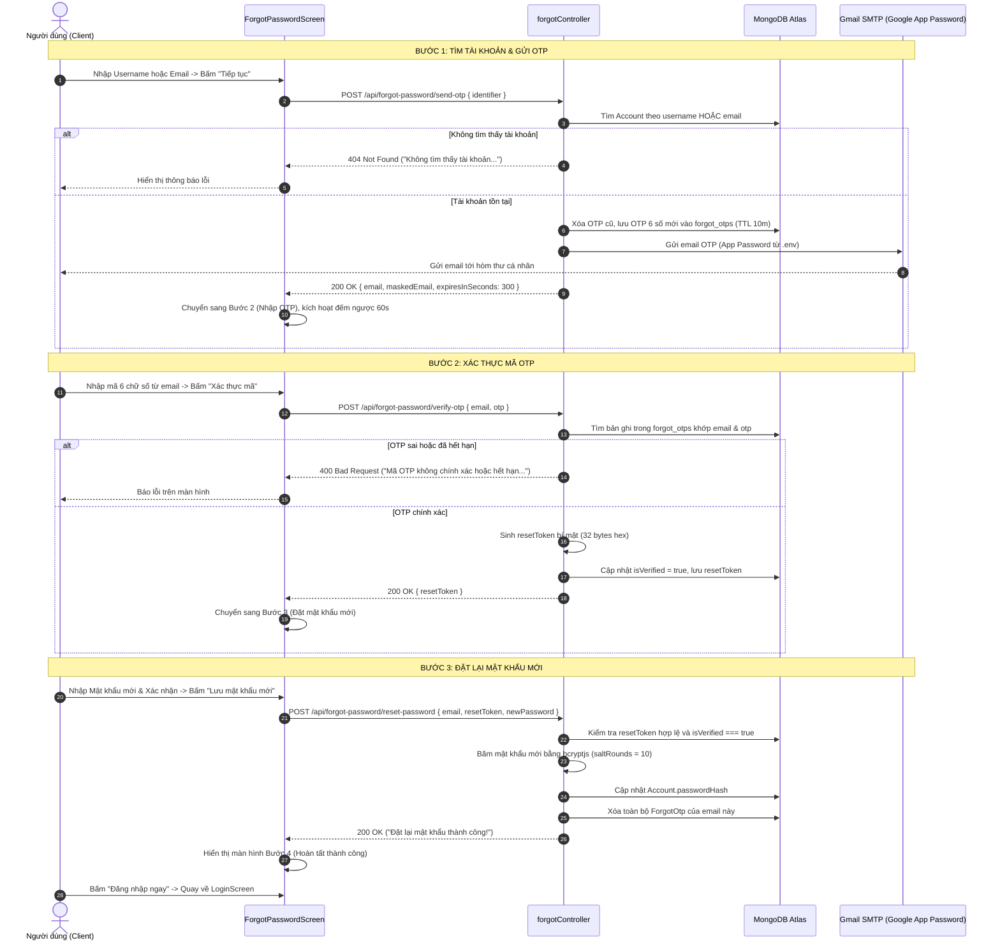

# Tính Năng Quên Mật Khẩu (Forgot Password)

Tài liệu chi tiết mô tả kiến trúc, luồng hoạt động và danh sách các file độc lập phục vụ báo cáo đồ án cho tính năng **Quên & Đặt lại mật khẩu** của nền tảng **TechShare**.

---

## 1. Danh sách các file riêng biệt (Dễ dàng báo cáo)

Tính năng được bóc tách hoàn toàn thành các file chuyên biệt theo kiến trúc MVC + Service-oriented:

### Backend (Server)

| STT | Tên File | Vai trò & Trách nhiệm |
| :-- | :--- | :--- |
| 1 | [`server/src/models/ForgotOtp.js`](../server/src/models/ForgotOtp.js) | **Model**: Định nghĩa Schema lưu mã OTP quên mật khẩu trong MongoDB, gồm `email`, `accountId`, `otp`, `resetToken`, `isVerified` và trường `createdAt` với TTL Index tự động xóa sau 10 phút (600 giây). |
| 2 | [`server/src/controllers/forgotController.js`](../server/src/controllers/forgotController.js) | **Controller**: Xử lý 4 nghiệp vụ chính:<br>• `findAccountAndSendOtp`: Tìm tài khoản qua username/email và gửi mã OTP.<br>• `verifyOtp`: Kiểm tra tính hợp lệ của mã 6 số và cấp `resetToken`.<br>• `resetPassword`: Băm mật khẩu mới bằng `bcryptjs` và cập nhật vào `Account`.<br>• `resendOtp`: Gửi lại mã OTP mới khi mã cũ hết hạn. |
| 3 | [`server/src/routes/forgotRoutes.js`](../server/src/routes/forgotRoutes.js) | **Routes**: Định nghĩa các API endpoints công khai (Public Routes) tại prefix `/api/forgot-password`. |
| 4 | [`server/src/services/emailService.js`](../server/src/services/emailService.js) | **Email Service**: Hàm `sendForgotPasswordOtpEmail` gửi email HTML chuẩn giao diện TechShare thông qua Gmail SMTP (`EMAIL_USER` và `EMAIL_PASS` App Password từ `.env`). |
| 5 | [`server/src/app.js`](../server/src/app.js) | **App Entry**: Khai báo và mount router tại `app.use('/api/forgot-password', forgotRoutes);`. |

### Frontend (Client)

| STT | Tên File | Vai trò & Trách nhiệm |
| :-- | :--- | :--- |
| 1 | [`client/src/services/forgotService.ts`](../client/src/services/forgotService.ts) | **Service**: Gọi Axios API và thực hiện validate dữ liệu form ở cả 3 bước (client-side) trước khi gửi request lên server. |
| 2 | [`client/src/screens/auth/ForgotPasswordScreen.tsx`](../client/src/screens/auth/ForgotPasswordScreen.tsx) | **Screen**: Giao diện người dùng đa bước (Multi-step Wizard) trực quan:<br>• Bước 1: Tìm tài khoản qua username/email.<br>• Bước 2: Nhập OTP 6 số (có đếm ngược 60s & nút gửi lại).<br>• Bước 3: Đặt mật khẩu mới & xác nhận mật khẩu (có nút ẩn/hiện mắt).<br>• Bước 4: Màn hình thành công dẫn về Đăng nhập. |
| 3 | [`client/src/navigation/RootNavigator.tsx`](../client/src/navigation/RootNavigator.tsx) | **Navigation**: Khai báo route `ForgotPassword` trong `RootStackParamList` và Stack Navigator. |
| 4 | [`client/src/screens/auth/LoginScreen.tsx`](../client/src/screens/auth/LoginScreen.tsx) | **Tích hợp**: Liên kết nút "Quên mật khẩu?" điều hướng trực tiếp sang màn hình `ForgotPassword`. |

---

## 2. Sơ đồ Luồng hoạt động (Activity Flow)



---

## 3. Chi tiết API Endpoints

### 3.1. Tìm tài khoản và gửi OTP
- **URL**: `POST /api/forgot-password/send-otp`
- **Body**:
  ```json
  {
    "identifier": "username_hoac_email"
  }
  ```
- **Response thành công (200)**:
  ```json
  {
    "success": true,
    "message": "Mã OTP đã được gửi về email ph***@gmail.com...",
    "email": "user@gmail.com",
    "maskedEmail": "us***@gmail.com",
    "expiresInSeconds": 300
  }
  ```

### 3.2. Xác thực mã OTP
- **URL**: `POST /api/forgot-password/verify-otp`
- **Body**:
  ```json
  {
    "email": "user@gmail.com",
    "otp": "123456"
  }
  ```
- **Response thành công (200)**:
  ```json
  {
    "success": true,
    "message": "Xác thực mã OTP thành công. Bạn có thể tiến hành tạo mật khẩu mới.",
    "email": "user@gmail.com",
    "resetToken": "982c82ac7f86fa0ef1148e71894f61d76395648668ecd22e1e773f37b545745b"
  }
  ```

### 3.3. Đặt lại mật khẩu mới
- **URL**: `POST /api/forgot-password/reset-password`
- **Body**:
  ```json
  {
    "email": "user@gmail.com",
    "resetToken": "982c82ac7f86fa0ef1148e71894f61d76395648668ecd22e1e773f37b545745b",
    "newPassword": "new_password_here",
    "confirmPassword": "new_password_here"
  }
  ```
- **Response thành công (200)**:
  ```json
  {
    "success": true,
    "message": "Đặt lại mật khẩu thành công! Bây giờ bạn có thể đăng nhập bằng mật khẩu mới."
  }
  ```

### 3.4. Gửi lại mã OTP
- **URL**: `POST /api/forgot-password/resend-otp`
- **Body**:
  ```json
  {
    "email": "user@gmail.com"
  }
  ```
- **Response thành công (200)**:
  ```json
  {
    "success": true,
    "message": "Mã OTP mới đã được gửi lại vào email ph***@gmail.com.",
    "email": "user@gmail.com",
    "expiresInSeconds": 300
  }
  ```

---

## 4. Các điểm mạnh về bảo mật & Thiết kế
1. **Bảo mật OTP & Token**: Mã OTP tự hủy sau 10 phút bằng MongoDB TTL index. Sau khi OTP được xác thực, hệ thống sinh một mã `resetToken` dùng 1 lần (one-time token) ngẫu nhiên 32 bytes hex, ngăn ngừa tấn công brute-force mật khẩu.
2. **Che giấu Email (Masking)**: Email được che bớt ký tự hiển thị (ví dụ: `ad***n@techshare.vn`) giúp tăng tính riêng tư.
3. **Mã hóa an toàn**: Mật khẩu mới được băm bằng thuật toán `bcrypt` với 10 vòng salt trước khi lưu vào cơ sở dữ liệu.
4. **Trải nghiệm người dùng cao cấp**: Giao diện có thanh tiến độ 3 bước, đếm ngược 60 giây gửi lại mã, nút bật/tắt hiển thị mật khẩu và xử lý lỗi mạng/lỗi nhập liệu tức thì ở phía client.
