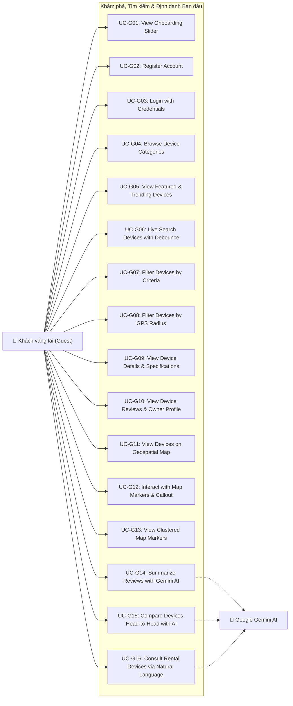
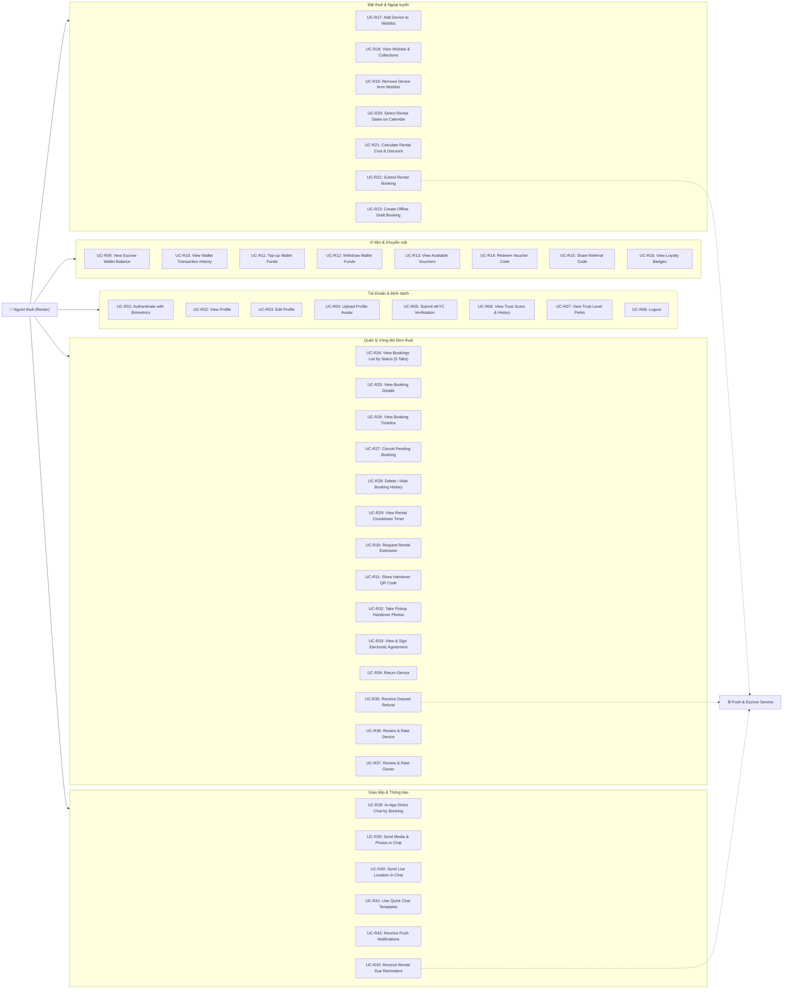
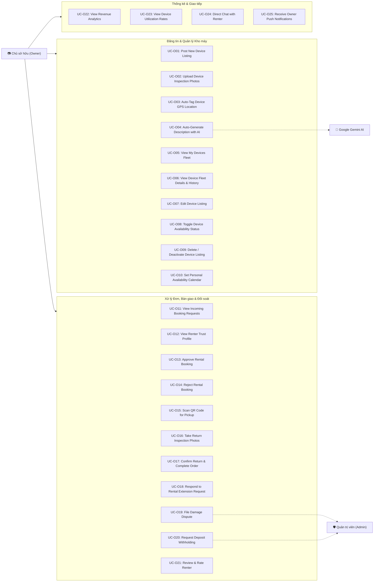
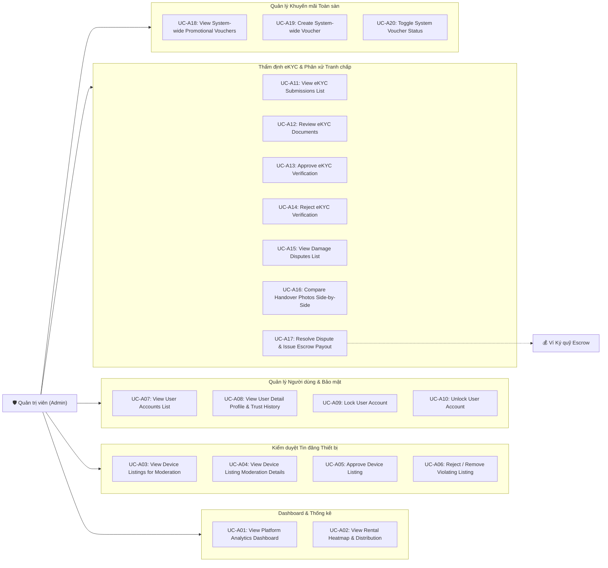

# 📋 TECHSHARE - TÀI LIỆU ĐẶC TẢ USE CASE HỆ THỐNG ĐƠN NGUYÊN THEO ROLE (ATOMIC USE CASES SPECIFICATION BY ROLES)
> **Dự án**: TechShare - Nền tảng Chia sẻ & Cho thuê Thiết bị Công nghệ tích hợp Trợ lý Trí tuệ Nhân tạo Google Gemini  
> **Môn học**: MMA301 - Cross-Platform Mobile Applications Development (FPT University)  
> **Quy mô nhóm**: 5 Thành viên (**An, Cường, Hạo, Kiên, Nhật (Lead)**)  
> **Công nghệ**: React Native (Expo SDK 57), Node.js (Express), MongoDB Atlas (GeoJSON 2dsphere), Google Gemini AI  
> **Tiêu chuẩn thiết kế**: Phân rã đơn nguyên (Atomic / Single-Action Use Case Decomposition) theo 4 Vai trò người dùng (**Guest, Renter, Owner, Admin**) kèm định danh Mức ưu tiên (**Priority**) và Độ phức tạp (**Complexity**).  
> **Tài liệu tham chiếu**: [FEATURES.md](file:///e:/Repository/tech-share-app/docs/FEATURES.md), [MEMBER_ASSIGNMENTS.md](file:///e:/Repository/tech-share-app/docs/MEMBER_ASSIGNMENTS.md), [ISSUES.md](file:///e:/Repository/tech-share-app/docs/ISSUES.md), [DATABASE_DESIGN.md](file:///e:/Repository/tech-share-app/docs/DATABASE_DESIGN.md)

---

## 📑 MỤC LỤC
1. [Xác định Tác nhân & Vai trò Hệ thống (System Roles & Actors)](#1-xác-định-tác-nhân--vai-trò-hệ-thống-system-roles--actors)
2. [Sơ đồ Use Case Đơn nguyên theo từng Role (Use Case Diagrams by Role)](#2-sơ-đồ-use-case-đơn-nguyên-theo-từng-role-use-case-diagrams-by-role)
   - 2.1. [Sơ đồ Use Case: Role GUEST (Khách vãng lai)](#21-sơ-đồ-use-case-role-guest-khách-vãng-lai)
   - 2.2. [Sơ đồ Use Case: Role RENTER (Người thuê thiết bị)](#22-sơ-đồ-use-case-role-renter-người-thuê-thiết-bị)
   - 2.3. [Sơ đồ Use Case: Role OWNER (Chủ sở hữu thiết bị)](#23-sơ-đồ-use-case-role-owner-chủ-sở-hữu-thiết-bị)
   - 2.4. [Sơ đồ Use Case: Role ADMIN (Quản trị viên)](#24-sơ-đồ-use-case-role-admin-quản-trị-viên)
3. [Danh mục Toàn bộ Use Case Đơn nguyên Phân bổ theo 4 Role & Độ phức tạp](#3-danh-mục-toàn-bộ-use-case-đơn-nguyên-phân-bổ-theo-4-role--độ-phức-tạp)
   - [👤 NHÓM 1: ROLE GUEST (Khách vãng lai - 16 Use Cases)](#-nhóm-1-role-guest-khách-vãng-lai---16-use-cases)
   - [🎒 NHÓM 2: ROLE RENTER (Người thuê thiết bị - 43 Use Cases)](#-nhóm-2-role-renter-người-thuê-thiết-bị---43-use-cases)
   - [📷 NHÓM 3: ROLE OWNER (Chủ sở hữu thiết bị - 25 Use Cases)](#-nhóm-3-role-owner-chủ-sở-hữu-thiết-bị---25-use-cases)
   - [🛡️ NHÓM 4: ROLE ADMIN (Quản trị viên hệ thống - 20 Use Cases)](#-nhóm-4-role-admin-quản-trị-viên-hệ-thống---20-use-cases)
4. [Đặc tả Chi tiết các Use Case Cốt lõi (Full Use Case Specifications)](#4-đặc-tả-chi-tiết-các-use-case-cốt-lõi-full-use-case-specifications)
   - [UC-G02: Register Account (Đăng ký tài khoản)](#uc-g02-register-account-đăng-ký-tài-khoản-mới)
   - [UC-R02: View Profile (Xem hồ sơ cá nhân)](#uc-r02-view-profile-xem-hồ-sơ-cá-nhân)
   - [UC-R03: Edit Profile (Chỉnh sửa thông tin hồ sơ)](#uc-r03-edit-profile-chỉnh-sửa-hồ-sơ-cá-nhân)
   - [UC-R22: Submit Rental Booking (Đặt thuê thiết bị)](#uc-r22-submit-rental-booking-xác-nhận-gửi-đơn-đặt-thuê)
   - [UC-R24: View Bookings List by Status (Xem danh sách đơn theo 5 tab)](#uc-r24-view-bookings-list-by-status-xem-danh-sách-đơn-thuê)
   - [UC-R25: View Booking Details (Xem chi tiết đơn thuê)](#uc-r25-view-booking-details-xem-chi-tiết-đơn-thuê)
   - [UC-R27: Cancel Pending Booking (Hủy đơn thuê khi chờ duyệt)](#uc-r27-cancel-pending-booking-hủy-đơn-thuê-khi-chờ-duyệt)
   - [UC-R28: Delete / Hide Booking History (Xóa/Ẩn đơn khỏi lịch sử)](#uc-r28-delete--hide-booking-history-xóa--ẩn-đơn-khỏi-lịch-sử)
   - [UC-O01: Post New Device Listing (Đăng tin cho thuê mới)](#uc-o01-post-new-device-listing-đăng-tin-cho-thuê-mới)
   - [UC-O13: Approve Rental Booking (Phê duyệt đơn thuê)](#uc-o13-approve-rental-booking-phê-duyệt-yêu-cầu-thuê)
   - [UC-O14: Reject Rental Booking (Từ chối đơn thuê)](#uc-o14-reject-rental-booking-từ-chối-yêu-cầu-thuê)
   - [UC-A17: Resolve Dispute & Issue Escrow Payout (Phân xử tranh chấp hư hỏng)](#uc-a17-resolve-dispute--issue-escrow-payout-phân-xử-tranh-chấp--giải-ngân-cọc)
5. [Ma trận Phân bổ Use Case Đơn nguyên theo 5 Thành viên Nhóm](#5-ma-trận-phân-bổ-use-case-đơn-nguyên-theo-5-thành-viên-nhóm)

---

## 1. XÁC ĐỊNH TÁC NHÂN & VAI TRÒ HỆ THỐNG (SYSTEM ROLES & ACTORS)

Hệ thống **TechShare** phân cấp quyền hạn và luồng nghiệp vụ chặt chẽ dựa trên 4 Role người dùng (Human Actors) cùng 2 Tác nhân hỗ trợ (Supporting Systems):

| Role / Tác nhân | Biểu tượng | Bản chất vai trò | Phạm vi chức năng & Quyền hạn |
| :--- | :---: | :--- | :--- |
| **Guest** | 👤 | Khách vãng lai (Chưa đăng nhập) | Cài đặt ứng dụng, xem Onboarding, khám phá 6 danh mục, tìm kiếm, xem chi tiết máy, tra cứu bản đồ vị trí GPS và trải nghiệm thử các tính năng AI tư vấn mà chưa cần tạo tài khoản. |
| **Renter** | 🎒 | Người thuê thiết bị (Đã đăng nhập) | Tìm kiếm, lưu/bỏ yêu thích, chọn ngày thuê trên lịch chống trùng, áp mã voucher, tạo đơn đặt thuê, **xem danh sách đơn, xem chi tiết, hủy đơn, xóa/ẩn đơn**, xuất trình QR nhận máy, hoàn trả, thanh toán cọc và đánh giá 2 chiều. |
| **Owner** | 📷 | Chủ sở hữu thiết bị (Đã xác thực) | Đăng tin cho thuê thiết bị, chụp ảnh kèm GPS, nhờ AI viết mô tả, **xem kho máy, xem chi tiết số liệu, sửa tin, bật/tắt trạng thái sẵn sàng/bảo trì/ẩn, xóa/ngừng cho thuê**, khóa lịch bận, duyệt/từ chối đơn, quét QR giao máy, đối soát ảnh trả máy, lập khiếu nại cọc và xem báo cáo doanh thu. |
| **Admin** | 🛡️ | Quản trị viên hệ thống | Giám sát toàn bộ nền tảng: xem dashboard phân tích doanh thu & heatmap, **kiểm duyệt tin đăng (xem, duyệt, gỡ bỏ)**, **quản lý người dùng (xem, khóa, mở khóa tài khoản)**, thẩm định CCCD duyệt eKYC, phân xử tranh chấp cọc Escrow và phát hành voucher toàn sàn. |
| **Google Gemini AI** | 🤖 | Hệ thống Trí tuệ Nhân tạo bên ngoài | Mô hình `gemini-1.5-flash` phân tích đánh giá Pros/Cons, so sánh đối đầu 2 dòng máy, tư vấn chọn máy theo ngôn ngữ tự nhiên và tự động soạn thảo nội dung tin đăng. |
| **Background / Push Service** | ⚙️ | Dịch vụ nền nội bộ | Hệ thống Expo Push Notifications gửi cảnh báo tức thì, bộ quét nhắc hạn trả máy tự động trước 6h/2h, dịch vụ ví ký quỹ Escrow và cơ chế đồng bộ ngoại tuyến (Offline Sync). |

> 💡 **Cơ chế Vai trò Kép (Dual-Role `both`)**: Trong TechShare, mọi tài khoản sau khi đăng ký thành công mặc định sở hữu vai trò kép `both`, cho phép một người dùng có thể linh hoạt chuyển đổi giữa vai trò **Renter** (đi thuê máy) và **Owner** (cho thuê máy) trên cùng một ứng dụng di động mà không cần đăng ký 2 tài khoản riêng biệt.

---

## 2. SƠ ĐỒ USE CASE ĐƠN NGUYÊN THEO TỪNG ROLE (USE CASE DIAGRAMS BY ROLE)

### 2.1. Sơ đồ Use Case: Role GUEST (Khách vãng lai)

---

### 2.2. Sơ đồ Use Case: Role RENTER (Người thuê thiết bị)

---

### 2.3. Sơ đồ Use Case: Role OWNER (Chủ sở hữu thiết bị)

---

### 2.4. Sơ đồ Use Case: Role ADMIN (Quản trị viên)

---

## 3. DANH MỤC TOÀN BỘ USE CASE ĐƠN NGUYÊN PHÂN BỔ THEO 4 ROLE & ĐỘ PHỨC TẠP

### 📌 Quy ước Phân loại Độ phức tạp (Complexity Standards)
* 🟢 **Simple (Đơn giản)**: Thao tác giao diện cơ bản, tra cứu / hiển thị dữ liệu hoặc cập nhật một trường dữ liệu độc lập.
* 🟡 **Medium (Trung bình)**: Thao tác có kiểm tra hợp lệ (Formik + Yup), truy vấn lọc đa điều kiện, xử lý tải ảnh / camera hoặc cập nhật trạng thái đơn hàng.
* 🔴 **Complex (Phức tạp)**: Thao tác chứa logic kinh doanh đa bên (Ví Escrow, QR Handover), thuật toán không gian GeoJSON / SuperCluster, tích hợp Gemini AI LLM, ký hợp đồng số hoặc cơ chế đồng bộ ngoại tuyến Offline Sync.

---

### 👤 NHÓM 1: ROLE GUEST (Khách vãng lai - 16 Use Cases)

#### UC-G01: View Onboarding Slider (Xem màn hình giới thiệu app) - 🟡 P1
- **Complexity**: Simple
- **Description**: Hiển thị 3 slide giới thiệu mô hình chia sẻ thiết bị, bảo hiểm cọc Escrow và trợ lý Gemini AI khi người dùng mở ứng dụng lần đầu tiên; tự động lưu trạng thái vào AsyncStorage.

#### UC-G02: Register Account (Đăng ký tài khoản mới) - 🔴 P0
- **Complexity**: Medium
- **Description**: Khách vãng lai đăng ký tài khoản thành viên mới bằng cách nhập Họ tên, Email, Mật khẩu, Số điện thoại và Địa chỉ; hệ thống kiểm tra hợp lệ Formik + Yup, mã hóa mật khẩu `bcryptjs` và cấp vai trò kép `both`.

#### UC-G03: Login with Credentials (Đăng nhập tài khoản) - 🔴 P0
- **Complexity**: Medium
- **Description**: Xác thực thông tin đăng nhập của người dùng qua Email và Mật khẩu, cấp phát JWT Bearer Token, lưu trữ và đồng bộ phiên đăng nhập an toàn vào AsyncStorage.

#### UC-G04: Browse Device Categories (Xem danh mục thiết bị) - 🔴 P0
- **Complexity**: Simple
- **Description**: Lướt xem 6 phân loại thiết bị công nghệ chính (Smartphone, Laptop, Camera, Drone, Audio, Gaming & Phụ kiện).

#### UC-G05: View Featured & Trending Devices (Xem danh sách thiết bị nổi bật) - 🔴 P0
- **Complexity**: Simple
- **Description**: Xem danh sách các thiết bị cho thuê được đánh giá cao (Featured), máy mới lên sàn (Newly Listed) và Carousel banner ưu đãi.

#### UC-G06: Live Search Devices with Debounce (Tìm kiếm thiết bị tức thì) - 🔴 P0
- **Complexity**: Medium
- **Description**: Tìm kiếm thiết bị thời gian thực theo tên model, thương hiệu với cơ chế Debounce 400ms chống nghẽn request; hiển thị gợi ý từ khóa xu hướng.

#### UC-G07: Filter Devices by Criteria (Lọc thiết bị theo giá và thương hiệu) - 🟡 P1
- **Complexity**: Medium
- **Description**: Áp dụng bộ lọc đa tiêu chí gồm thanh trượt khoảng giá thuê/ngày (50k - 5tr), thương hiệu sản xuất (Apple, Sony, DJI...) và tiêu chí sắp xếp (giá, sao).

#### UC-G08: Filter Devices by GPS Radius (Lọc thiết bị theo bán kính GPS) - 🟡 P1
- **Complexity**: Medium
- **Description**: Chọn bán kính khoảng cách GPS (2km, 5km, 10km, 20km) tính từ vị trí hiện tại của thiết bị để tìm máy ở gần nhất qua GeoJSON `$nearSphere`.

#### UC-G09: View Device Details & Specifications (Xem chi tiết thiết bị & thông số) - 🔴 P0
- **Complexity**: Medium
- **Description**: Xem toàn bộ album ảnh thực tế Carousel, bảng thông số kỹ thuật chi tiết (CPU, RAM, Cảm biến, Pin) và chính sách cọc/giấy tờ thuê.

#### UC-G10: View Device Reviews & Owner Profile (Xem đánh giá & hồ sơ chủ máy) - 🟡 P1
- **Complexity**: Simple
- **Description**: Xem tổng điểm đánh giá sao, nhận xét từ những người thuê trước kèm ảnh chụp thực tế và thông tin uy tín của chủ máy.

#### UC-G11: View Devices on Geospatial Map (Xem bản đồ GPS vị trí thiết bị lân cận) - 🔴 P0
- **Complexity**: Complex
- **Description**: Màn hình bản đồ toàn màn hình tích hợp `react-native-maps`, xác định vị trí thực tế của người dùng qua `expo-location` và định vị thiết bị bằng GeoJSON Point.

#### UC-G12: Interact with Map Markers & Callout (Chạm ghim bản đồ & xem thẻ tóm tắt) - 🟡 P1
- **Complexity**: Medium
- **Description**: Chạm vào từng ghim Marker trên bản đồ để mở thẻ Callout card tóm tắt (ảnh, tên máy, giá thuê/ngày, khoảng cách km) kèm nút dẫn tới trang chi tiết.

#### UC-G13: View Clustered Map Markers (Xem phân cụm ghim bản đồ khi thu phóng) - 🟢 P2
- **Complexity**: Complex
- **Description**: Tự động gom cụm các ghim thiết bị ở gần nhau thành vòng tròn số lượng bằng thuật toán SuperCluster khi thu nhỏ tầm nhìn bản đồ.

#### UC-G14: Summarize Reviews with Gemini AI (Tóm tắt đánh giá bằng Gemini AI) - 🔴 P0
- **Complexity**: Complex
- **Description**: Gọi API `gemini-1.5-flash` phân tích toàn bộ nhận xét cộng đồng thành 3 khối giao diện trực quan: Thẻ xanh (Ưu điểm), Thẻ đỏ (Nhược điểm) và Lời khuyên (Phù hợp nhất).

#### UC-G15: Compare Devices Head-to-Head with AI (So sánh đối đầu 2 thiết bị bằng AI) - 🟡 P1
- **Complexity**: Complex
- **Description**: Chọn 2 thiết bị công nghệ bất kỳ để Gemini AI tạo bảng so sánh đối đầu toàn diện: sức mạnh vi xử lý/cảm biến, pin, trọng lượng và tỷ lệ hiệu năng trên giá thuê.

#### UC-G16: Consult Rental Devices via Natural Language (Tư vấn tìm máy bằng ngôn ngữ tự nhiên) - 🟢 P2
- **Complexity**: Complex
- **Description**: Khách nhập câu hỏi nhu cầu tự nhiên (ví dụ: *"Cần quay vlog du lịch biển dưới 400k/ngày"*); Gemini AI phân tích câu hỏi và gợi ý 2 dòng máy tối ưu nhất kèm liên kết xem chi tiết.

---

### 🎒 NHÓM 2: ROLE RENTER (Người thuê thiết bị - 43 Use Cases)

#### UC-R01: Authenticate with Biometrics (Đăng nhập bằng FaceID hoặc Vân tay) - 🟢 P2
- **Complexity**: Medium
- **Description**: Mở khóa ứng dụng nhanh chóng và xác thực nhanh các giao dịch bằng cảm biến sinh trắc học `expo-local-authentication`.

#### UC-R02: View Profile (Xem hồ sơ cá nhân) - 🔴 P0
- **Complexity**: Simple
- **Description**: Xem thông tin tài khoản cá nhân: họ tên, email, số điện thoại, địa chỉ nhận hàng mặc định, huy hiệu xác thực và ảnh đại diện.

#### UC-R03: Edit Profile (Chỉnh sửa thông tin hồ sơ) - 🔴 P0
- **Complexity**: Medium
- **Description**: Cập nhật thông tin họ tên, số điện thoại liên lạc và địa chỉ nhận thiết bị mặc định của tài khoản.

#### UC-R04: Upload Profile Avatar (Cập nhật ảnh đại diện cá nhân) - 🟡 P1
- **Complexity**: Medium
- **Description**: Chọn ảnh từ thư viện ảnh hoặc chụp ảnh mới từ camera để tải lên cập nhật ảnh đại diện cá nhân (avatar).

#### UC-R05: Submit eKYC Verification (Nộp hồ sơ xác thực CCCD) - 🟡 P1
- **Complexity**: Complex
- **Description**: Chụp và tải lên ảnh 2 mặt Căn cước công dân (CCCD) cùng 1 ảnh chân dung selfie để gửi yêu cầu xét duyệt cấp Tích xanh uy tín.

#### UC-R06: View Trust Score & History (Xem điểm tín nhiệm công nghệ & lịch sử) - 🟢 P2
- **Complexity**: Simple
- **Description**: Hiển thị điểm số uy tín công nghệ cá nhân (khởi điểm 100 điểm) và nhật ký lịch sử cộng điểm / trừ điểm qua các đơn hàng.

#### UC-R07: View Trust Level Perks (Xem đặc quyền cấp tín nhiệm) - 🟢 P2
- **Complexity**: Simple
- **Description**: Xem danh sách các đặc quyền tương ứng với điểm uy tín: giảm 20% tiền cọc, miễn cọc máy dưới 5 triệu khi đạt thứ hạng Gold/Platinum.

#### UC-R08: Logout (Đăng xuất tài khoản) - 🔴 P0
- **Complexity**: Simple
- **Description**: Hủy phiên làm việc hiện tại, xóa sạch JWT Token khỏi AsyncStorage và chuyển hướng an toàn về màn hình Đăng nhập.

#### UC-R09: View Escrow Wallet Balance (Xem số dư ví tiền nội bộ & cọc Escrow) - 🟢 P2
- **Complexity**: Simple
- **Description**: Xem chi tiết hai nguồn số dư trong ví TechShare: Số dư khả dụng và Số dư tiền cọc đang bị đóng băng trong ví ký quỹ Escrow.

#### UC-R10: View Wallet Transaction History (Xem lịch sử giao dịch ví) - 🟢 P2
- **Complexity**: Simple
- **Description**: Hiển thị danh sách toàn bộ các giao dịch nạp tiền, rút tiền, đặt cọc, hoàn cọc kèm mã giao dịch và mốc thời gian chi tiết.

#### UC-R11: Top-up Wallet Funds (Nạp tiền vào ví nội bộ) - 🟢 P2
- **Complexity**: Medium
- **Description**: Nhập số tiền muốn nạp và thực hiện nạp tiền vào ví nội bộ (Mock Top-up) phục vụ thanh toán tiền thuê và tiền cọc.

#### UC-R12: Withdraw Wallet Funds (Rút tiền từ ví về tài khoản ngân hàng) - 🟢 P2
- **Complexity**: Medium
- **Description**: Nhập thông tin số tài khoản ngân hàng, tên ngân hàng và số tiền muốn rút từ số dư khả dụng về tài khoản cá nhân.

#### UC-R13: View Available Promotion Vouchers (Xem kho voucher khuyến mãi) - 🟡 P1
- **Complexity**: Simple
- **Description**: Xem danh sách toàn bộ các mã voucher giảm giá đang sở hữu (mức giảm %, hạn sử dụng, điều kiện áp dụng).

#### UC-R14: Redeem Voucher Code (Áp dụng mã giảm giá voucher) - 🟡 P1
- **Complexity**: Medium
- **Description**: Chọn áp dụng mã voucher có sẵn hoặc nhập thủ công mã khuyến mãi để được khấu trừ trực tiếp vào tổng chi phí đơn thuê.

#### UC-R15: Share Referral Code (Chia sẻ mã giới thiệu bạn bè) - 🟢 P2
- **Complexity**: Simple
- **Description**: Sao chép mã giới thiệu độc nhất của tài khoản và chia sẻ cho bạn bè để cả hai cùng nhận voucher quà tặng khi tạo tài khoản.

#### UC-R16: View Loyalty Badges (Xem huy hiệu thành viên & cấp bậc) - 🟢 P2
- **Complexity**: Simple
- **Description**: Xem danh sách các huy hiệu thành viên đã đạt được (Tân binh, Người thuê thân thiện, Reviewer kỳ cựu) theo số lượng đơn hoàn thành.

#### UC-R17: Add Device to Wishlist (Thả tim lưu thiết bị vào yêu thích) - 🟡 P1
- **Complexity**: Simple
- **Description**: Nhấn biểu tượng trái tim tại thẻ thiết bị hoặc trang chi tiết để lưu máy vào danh sách theo dõi cá nhân.

#### UC-R18: View Wishlist & Collections (Xem danh sách thiết bị yêu thích) - 🟡 P1
- **Complexity**: Simple
- **Description**: Màn hình danh sách toàn bộ các thiết bị đã thả tim, hỗ trợ phân loại theo bộ sưu tập (Du lịch, Kỷ yếu, Phim ảnh) và xem ngoại tuyến.

#### UC-R19: Remove Device from Wishlist (Bỏ lưu thiết bị khỏi yêu thích) - 🟡 P1
- **Complexity**: Simple
- **Description**: Chạm bỏ chọn biểu tượng trái tim để gỡ thiết bị khỏi danh sách yêu thích cá nhân.

#### UC-R20: Select Rental Dates on Interactive Calendar (Chọn ngày thuê trên lịch) - 🔴 P0
- **Complexity**: Complex
- **Description**: Chọn ngày nhận máy và ngày trả máy trên bộ lịch `DateRangePicker`; hệ thống tự động kiểm tra và bôi xám các ngày máy đã kín lịch hoặc ngày bận của chủ.

#### UC-R21: Calculate Rental Cost & Long-term Discount (Tính chi phí thuê & chiết khấu) - 🔴 P0
- **Complexity**: Medium
- **Description**: Hệ thống tự động tính toán số ngày thuê, nhân đơn giá, tự động áp mức chiết khấu thuê dài ngày (giảm 10% từ 3 ngày, giảm 20% từ 7 ngày) và cộng tiền cọc.

#### UC-R22: Submit Rental Booking (Xác nhận gửi đơn đặt thuê) - 🔴 P0
- **Complexity**: Complex
- **Description**: Người thuê chọn hình thức nhận máy (trực tiếp hoặc giao tận nơi), kiểm tra bảng chi phí và bấm xác nhận gửi đơn sang trạng thái `pending`, ghi nhận biến động ví và gửi Push Notification.

#### UC-R23: Create Offline Draft Booking (Tạo đơn thuê nháp ngoại tuyến) - 🟢 P2
- **Complexity**: Complex
- **Description**: Lưu đơn đặt thuê nháp vào hàng đợi cục bộ qua AsyncStorage khi mất kết nối mạng và tự động đồng bộ gửi đơn lên máy chủ khi có Internet qua background listener.

#### UC-R24: View Bookings List by Status (Xem danh sách đơn thuê qua 5 tab) - 🔴 P0
- **Complexity**: Medium
- **Description**: Màn hình quản lý danh sách toàn bộ các đơn thuê của cá nhân được phân loại theo 5 tab tiến trình: Chờ duyệt (`pending`), Đã duyệt (`approved`), Đang thuê (`active`), Đã hoàn tất (`completed`), Đã hủy (`cancelled`).

#### UC-R25: View Booking Details (Xem chi tiết đơn thuê) - 🔴 P0
- **Complexity**: Medium
- **Description**: Xem toàn bộ thông tin chi tiết một đơn thuê: ảnh máy, thông tin chủ máy, tổng tiền thuê, tiền cọc Escrow, phương thức nhận máy và địa chỉ giao nhận.

#### UC-R26: View Booking Timeline (Xem sơ đồ tiến trình Timeline đơn thuê) - 🟡 P1
- **Complexity**: Simple
- **Description**: Xem sơ đồ các mốc thời gian trực quan của đơn hàng: Thời điểm đặt đơn -> Chủ duyệt -> Quét QR bàn giao -> Hạn trả máy -> Hoàn tất đơn.

#### UC-R27: Cancel Pending Booking (Hủy đơn thuê khi chờ duyệt) - 🔴 P0
- **Complexity**: Medium
- **Description**: Cho phép người thuê hủy đơn khi đơn còn ở trạng thái `pending`, nhập lý do hủy; hệ thống tự động hoàn 100% tiền cọc và giải phóng lịch máy.

#### UC-R28: Delete / Hide Booking History (Xóa / Ẩn đơn khỏi lịch sử cá nhân) - 🟡 P1
- **Complexity**: Simple
- **Description**: Cho phép người thuê ẩn các đơn hàng đã kết thúc (`completed`, `cancelled`) khỏi danh sách hiển thị cá nhân (Soft Delete) giúp màn hình gọn gàng mà không mất dữ liệu kế toán.

#### UC-R29: View Rental Countdown Timer (Xem đồng hồ đếm ngược thời gian thuê) - 🟡 P1
- **Complexity**: Medium
- **Description**: Hiển thị đồng hồ đếm ngược thời gian thực (ngày, giờ, phút) còn lại của gói thuê ngay trên màn hình chi tiết đơn đang thuê (`active`).

#### UC-R30: Request Rental Extension (Gửi yêu cầu gia hạn ngày thuê) - 🟡 P1
- **Complexity**: Medium
- **Description**: Chọn số ngày muốn thuê thêm và gửi yêu cầu gia hạn trực tiếp tới chủ máy kèm chi phí phát sinh ước tính để chủ máy xem xét phê duyệt.

#### UC-R31: Show Handover QR Code (Xuất trình mã QR nhận máy) - 🟡 P1
- **Complexity**: Medium
- **Description**: Hiển thị mã QR định danh đơn hàng trên màn hình điện thoại để chủ máy quét xác nhận gặp mặt bàn giao thiết bị.

#### UC-R32: Take Pickup Handover Photos (Chụp ảnh hiện trạng máy lúc nhận) - 🟡 P1
- **Complexity**: Medium
- **Description**: Sử dụng camera chụp 4 góc máy và phụ kiện kèm theo (`handoverPhotos.beforeRental`) lúc nhận máy để lưu bằng chứng đối soát ban đầu.

#### UC-R33: View & Sign Electronic Rental Agreement (Xem và ký hợp đồng điện tử) - 🟡 P1
- **Complexity**: Complex
- **Description**: Xem các điều khoản quyền và nghĩa vụ trong hợp đồng thuê điện tử và ký xác nhận trực tiếp bằng ngón tay trên màn hình cảm ứng khi bàn giao.

#### UC-R34: Return Device (Gặp chủ máy hoàn trả thiết bị) - 🔴 P0
- **Complexity**: Simple
- **Description**: Người thuê gặp lại chủ máy đúng hẹn để hoàn trả thiết bị và phụ kiện sau khi hết thời gian thuê.

#### UC-R35: Receive Deposit Refund (Nhận hoàn tiền cọc từ ví Escrow) - 🔴 P0
- **Complexity**: Complex
- **Description**: Sau khi chủ máy kiểm tra và xác nhận hoàn tất đơn, hệ thống tự động giải ngân hoàn 100% tiền cọc bảo đảm từ ví ký quỹ Escrow về ví khả dụng của khách.

#### UC-R36: Review & Rate Device (Đánh giá và chấm điểm thiết bị) - 🔴 P0
- **Complexity**: Medium
- **Description**: Chấm điểm từ 1 đến 5 sao và viết nhận xét về chất lượng hoạt động, độ mới của thiết bị kèm ảnh chụp thật sau khi đơn hoàn tất.

#### UC-R37: Review & Rate Owner (Đánh giá và chấm điểm chủ máy) - 🔴 P0
- **Complexity**: Medium
- **Description**: Chấm điểm từ 1 đến 5 sao và nhận xét về thái độ hỗ trợ, độ đúng hẹn, sự nhiệt tình của chủ máy sau khi kết thúc đơn thuê.

#### UC-R38: In-App Direct Chat by Booking (Nhắn tin trực tiếp theo đơn thuê) - 🟡 P1
- **Complexity**: Complex
- **Description**: Kênh trao đổi tin nhắn trực tiếp thời gian thực tích hợp Socket.io được tạo riêng biệt theo từng mã đơn giữa người thuê và chủ máy.

#### UC-R39: Send Media & Photos in Chat (Gửi ảnh chụp trong khung chat) - 🟡 P1
- **Complexity**: Medium
- **Description**: Chụp và gửi ảnh phụ kiện hoặc tình trạng máy qua tin nhắn chat để hai bên tiện trao đổi.

#### UC-R40: Send Live Location in Chat (Chia sẻ vị trí điểm hẹn gặp mặt) - 🟡 P1
- **Complexity**: Medium
- **Description**: Chia sẻ tọa độ GPS vị trí gặp mặt hiện tại trên bản đồ trực tiếp vào đoạn chat để hẹn nhận/trả máy dễ dàng.

#### UC-R41: Use Quick Chat Templates (Sử dụng mẫu tin nhắn nhanh) - 🟡 P1
- **Complexity**: Simple
- **Description**: Chạm các nút tin nhắn soạn sẵn (ví dụ: *"Đã sạc đầy pin chưa?"*, *"Mình đã tới điểm hẹn"*) để gửi tin nhắn tức thì.

#### UC-R42: Receive Push Notifications (Nhận thông báo đẩy tiến trình đơn) - 🔴 P0
- **Complexity**: Medium
- **Description**: Nhận thông báo đẩy tự động qua Expo Notifications khi chủ máy duyệt đơn, từ chối đơn, phát sinh tin nhắn mới hoặc có thay đổi trạng thái.

#### UC-R43: Receive Rental Due Reminders (Nhận nhắc nhở hạn trả máy trước 6h/2h) - 🔴 P0
- **Complexity**: Complex
- **Description**: Hệ thống dịch vụ nền tự động gửi cảnh báo nhắc nhở sắp đến hạn hoàn trả thiết bị trước 6 tiếng và trước 2 tiếng để khách không bị trễ hẹn.

---

### 📷 NHÓM 3: ROLE OWNER (Chủ sở hữu thiết bị - 25 Use Cases)

#### UC-O01: Post New Device Listing (Tạo tin đăng cho thuê thiết bị mới) - 🔴 P0
- **Complexity**: Medium
- **Description**: Nhập tên thiết bị, danh mục, hãng sản xuất, năm sản xuất, tình trạng máy (99%, 95%), giá thuê/ngày, tiền cọc bảo đảm và bảng thông số kỹ thuật (Specs).

#### UC-O02: Upload Device Inspection Photos (Tải lên album ảnh thiết bị) - 🔴 P0
- **Complexity**: Medium
- **Description**: Tải lên tối đa 8 ảnh thực tế chụp từ camera hoặc thư viện (`expo-image-picker`), hỗ trợ sắp xếp thứ tự ảnh bìa.

#### UC-O03: Auto-Tag Device GPS Location (Tự động gắn tọa độ vị trí cất máy) - 🔴 P0
- **Complexity**: Medium
- **Description**: Tự động lấy tọa độ GPS thực tế của vị trí cất giữ thiết bị qua `expo-location` và lưu chuẩn GeoJSON Point vào CSDL.

#### UC-O04: Auto-Generate Description with Gemini AI (Tự động tạo mô tả tin đăng bằng AI) - 🟢 P2
- **Complexity**: Complex
- **Description**: Nhập tên model máy, nhấn nút AI để Gemini AI tự động soạn thảo bài viết giới thiệu thiết bị chuyên nghiệp và tự điền bảng thông số kỹ thuật chuẩn.

#### UC-O05: View My Devices Fleet (Xem danh sách kho máy cá nhân) - 🔴 P0
- **Complexity**: Simple
- **Description**: Hiển thị danh sách toàn bộ thiết bị đang sở hữu kèm số liệu thống kê: số lượt đã cho thuê, doanh thu tích lũy và điểm đánh giá sao.

#### UC-O06: View Device Fleet Details & History (Xem chi tiết thiết bị & lịch sử cho thuê) - 🟡 P1
- **Complexity**: Medium
- **Description**: Xem trang chi tiết cấu hình máy và nhật ký toàn bộ các đơn hàng đã từng cho thuê thiết bị này.

#### UC-O07: Edit Device Listing (Chỉnh sửa thông tin tin đăng thiết bị) - 🔴 P0
- **Complexity**: Medium
- **Description**: Cho phép cập nhật giá thuê/ngày, tiền cọc bảo đảm, mô tả chi tiết, danh sách phụ kiện đi kèm của thiết bị đã đăng.

#### UC-O08: Toggle Device Availability Status (Chuyển đổi trạng thái máy nhanh) - 🔴 P0
- **Complexity**: Simple
- **Description**: Công tắc chuyển đổi nhanh 3 trạng thái hoạt động của thiết bị: `available` (sẵn sàng), `maintenance` (bảo dưỡng), `hidden` (tạm ẩn).

#### UC-O09: Delete / Deactivate Device Listing (Xóa hoặc ngừng cho thuê thiết bị) - 🟡 P1
- **Complexity**: Medium
- **Description**: Cho phép chủ máy ngừng cho thuê hoặc xóa thiết bị khỏi kho cá nhân (hệ thống chặn xóa nếu thiết bị đang có đơn chạy).

#### UC-O10: Set Personal Availability Calendar (Khóa lịch bận cá nhân) - 🟡 P1
- **Complexity**: Medium
- **Description**: Mở lịch thiết bị và đánh dấu các ngày cá nhân cần dùng máy hoặc bận việc; hệ thống tự động khóa những ngày này trên lịch đặt của khách.

#### UC-O11: View Incoming Booking Requests (Xem danh sách yêu cầu thuê máy mới) - 🔴 P0
- **Complexity**: Simple
- **Description**: Xem danh sách các đơn đặt thuê mới từ khách hàng đang ở trạng thái chờ duyệt (`pending`).

#### UC-O12: View Renter Trust Profile (Xem hồ sơ uy tín của khách thuê) - 🔴 P0
- **Complexity**: Simple
- **Description**: Xem điểm tín nhiệm Trust Score, số đơn đã hoàn thành và các nhận xét từ những chủ máy khác trước khi quyết định duyệt đơn.

#### UC-O13: Approve Rental Booking (Phê duyệt yêu cầu đặt thuê) - 🔴 P0
- **Complexity**: Medium
- **Description**: Chủ máy nhấn nút chấp thuận cho khách thuê (`approved`), hệ thống khóa lịch thuê và gửi thông báo cho khách.

#### UC-O14: Reject Rental Booking (Từ chối yêu cầu đặt thuê kèm lý do) - 🔴 P0
- **Complexity**: Medium
- **Description**: Chủ máy từ chối yêu cầu thuê máy của khách (`rejected`), nhập lý do từ chối rõ ràng và hệ thống hoàn cọc lại cho khách.

#### UC-O15: Scan QR Code for Pickup (Quét mã QR bàn giao máy cho khách) - 🔴 P0
- **Complexity**: Complex
- **Description**: Dùng camera quét mã QR trên điện thoại của khách thuê để xác thực gặp mặt và kích hoạt trạng thái đơn sang `active`.

#### UC-O16: Take Return Inspection Photos (Chụp ảnh kiểm tra hiện trạng khi nhận lại máy) - 🔴 P0
- **Complexity**: Medium
- **Description**: Khi khách mang máy đến trả, chủ máy chụp ảnh đối soát hiện trạng thiết bị sau thuê (`handoverPhotos.afterRental`).

#### UC-O17: Confirm Return & Complete Order (Xác nhận máy nguyên vẹn & hoàn tất đơn) - 🔴 P0
- **Complexity**: Complex
- **Description**: Kiểm tra thiết bị không có hư hại, nhấn nút xác nhận hoàn tất đơn (`completed`) để hệ thống giải ngân hoàn cọc 100% cho khách qua Escrow.

#### UC-O18: Respond to Rental Extension Request (Phản hồi yêu cầu gia hạn thuê) - 🟡 P1
- **Complexity**: Medium
- **Description**: Xem số ngày khách xin gia hạn và phụ phí đề xuất; đưa ra quyết định bấm Chấp thuận (`approve`) hoặc Từ chối (`reject`).

#### UC-O19: File Damage Dispute (Lập phiếu khiếu nại thiết bị hư hỏng) - 🟡 P1
- **Complexity**: Complex
- **Description**: Trường hợp máy bị nứt vỡ, trầy xước nặng hoặc hỏng hóc, chủ máy từ chối hoàn tất và tạo phiếu khiếu nại đính kèm ảnh bằng chứng.

#### UC-O20: Request Deposit Withholding (Yêu cầu giữ cọc đền bù hư hại) - 🟡 P1
- **Complexity**: Medium
- **Description**: Nhập số tiền đề xuất bồi thường thiệt hại và yêu cầu đóng băng cọc gửi lên Quản trị viên phân xử.

#### UC-O21: Review & Rate Renter (Đánh giá và chấm điểm khách thuê) - 🔴 P0
- **Complexity**: Medium
- **Description**: Chấm điểm từ 1 đến 5 sao và để lại nhận xét công khai về ý thức giữ gìn máy, độ đúng hẹn khi hoàn trả của người thuê.

#### UC-O22: View Revenue Analytics (Xem báo cáo thống kê doanh thu) - 🟡 P1
- **Complexity**: Complex
- **Description**: Màn hình biểu đồ phân tích tổng doanh thu cho thuê theo tuần, tháng, quý và lịch sử các khoản tiền đã nhận.

#### UC-O23: View Device Utilization Rates (Xem thống kê tỷ lệ lấp đầy kho máy) - 🟡 P1
- **Complexity**: Medium
- **Description**: Thống kê tỷ lệ phần trăm số ngày máy được thuê trên tổng số ngày trong tháng (Utilization Rate %) để tối ưu giá thuê.

#### UC-O24: Direct Chat with Renter (Nhắn tin 1-1 với khách thuê theo đơn) - 🟡 P1
- **Complexity**: Complex
- **Description**: Kênh chat trực tiếp qua Socket.io với khách thuê để trao đổi về cách sử dụng thiết bị, điểm hẹn và giờ bàn giao máy.

#### UC-O25: Receive Owner Push Notifications (Nhận thông báo đẩy dành cho chủ máy) - 🔴 P0
- **Complexity**: Medium
- **Description**: Nhận thông báo đẩy tức thì khi có khách đặt thuê máy mới, khi khách hủy đơn, khi khách gửi yêu cầu gia hạn hoặc có tin nhắn mới.

---

### 🛡️ NHÓM 4: ROLE ADMIN (Quản trị viên hệ thống - 20 Use Cases)

#### UC-A01: View Platform Analytics Dashboard (Xem bảng điều khiển phân tích toàn sàn) - 🟡 P1
- **Complexity**: Complex
- **Description**: Bảng điều khiển tổng quan hiển thị số lượng người dùng, tổng số thiết bị, số đơn đang chạy và tổng doanh thu toàn sàn.

#### UC-A02: View Rental Heatmap & Distribution (Xem bản đồ nhiệt & phân bổ danh mục) - 🟢 P2
- **Complexity**: Complex
- **Description**: Xem biểu đồ tỷ trọng các danh mục thiết bị được thuê nhiều nhất và bản đồ nhiệt (Heatmap) mật độ giao dịch theo khu vực địa lý.

#### UC-A03: View Device Listings for Moderation (Xem danh sách tin đăng cần kiểm duyệt) - 🟡 P1
- **Complexity**: Simple
- **Description**: Xem danh sách toàn bộ các tin đăng thiết bị mới hoặc các tin đăng bị người dùng báo cáo vi phạm.

#### UC-A04: View Device Listing Moderation Details (Xem chi tiết tin đăng kiểm duyệt) - 🟡 P1
- **Complexity**: Medium
- **Description**: Xem toàn bộ album ảnh, thông số kỹ thuật, giá cọc, giấy tờ máy và vị trí GPS của tin đăng để thẩm định.

#### UC-A05: Approve Device Listing (Phê duyệt tin đăng thiết bị) - 🟡 P1
- **Complexity**: Simple
- **Description**: Quản trị viên bấm phê duyệt cho phép tin đăng hợp lệ xuất hiện công khai trên sàn tìm kiếm và bản đồ.

#### UC-A06: Reject / Remove Violating Listing (Từ chối hoặc gỡ bỏ tin đăng vi phạm) - 🟡 P1
- **Complexity**: Medium
- **Description**: Từ chối duyệt hoặc gỡ bỏ tin đăng sai quy định, ảnh mờ hoặc thông tin giả mạo kèm lý do thông báo cho chủ máy.

#### UC-A07: View User Accounts List (Xem danh sách tài khoản người dùng) - 🟡 P1
- **Complexity**: Simple
- **Description**: Tìm kiếm và quản lý danh sách toàn bộ tài khoản thành viên trong hệ thống (lọc theo vai trò, trạng thái kích hoạt).

#### UC-A08: View User Detail Profile & Trust History (Xem chi tiết tài khoản & điểm tín nhiệm) - 🟡 P1
- **Complexity**: Medium
- **Description**: Xem chi tiết hồ sơ cá nhân, điểm uy tín Trust Score, lịch sử đơn thuê và các đánh giá vi phạm của người dùng.

#### UC-A09: Lock User Account (Khóa tài khoản vi phạm) - 🟡 P1
- **Complexity**: Medium
- **Description**: Thực hiện khóa tạm thời hoặc khóa vĩnh viễn các tài khoản có hành vi gian lận, trộm cắp máy hoặc vi phạm chính sách cộng đồng.

#### UC-A10: Unlock User Account (Mở khóa tài khoản người dùng) - 🟡 P1
- **Complexity**: Simple
- **Description**: Khôi phục trạng thái hoạt động cho tài khoản người dùng sau khi đã xác minh giải quyết xong các khiếu nại.

#### UC-A11: View eKYC Submissions List (Xem danh sách hồ sơ eKYC chờ duyệt) - 🟡 P1
- **Complexity**: Simple
- **Description**: Tiếp nhận danh sách các hồ sơ người dùng gửi yêu cầu xác minh danh tính điện tử kèm mốc thời gian nộp.

#### UC-A12: Review eKYC Documents (Đối soát ảnh chụp giấy tờ CCCD) - 🟡 P1
- **Complexity**: Medium
- **Description**: Màn hình phóng to đối soát ảnh chụp 2 mặt Căn cước công dân và ảnh chân dung selfie để kiểm tra tính xác thực.

#### UC-A13: Approve eKYC Verification (Phê duyệt cấp tích xanh uy tín) - 🟡 P1
- **Complexity**: Medium
- **Description**: Admin bấm duyệt cấp huy hiệu Tích xanh xác thực (`isVerified: true`) cho tài khoản đạt chuẩn.

#### UC-A14: Reject eKYC Verification (Từ chối hồ sơ xác thực CCCD kèm lý do) - 🟡 P1
- **Complexity**: Medium
- **Description**: Từ chối hồ sơ xác minh danh tính do ảnh mờ, mất góc hoặc không trùng khớp khuôn mặt kèm thông báo yêu cầu chụp lại.

#### UC-A15: View Damage Disputes List (Xem danh sách đơn hàng tranh chấp cọc) - 🟡 P1
- **Complexity**: Simple
- **Description**: Xem danh sách các hồ sơ khiếu nại hư hỏng thiết bị do chủ máy gửi lên cần Quản trị viên phân xử.

#### UC-A16: Compare Handover Photos Side-by-Side (Màn hình đối chiếu song song ảnh bàn giao) - 🟡 P1
- **Complexity**: Complex
- **Description**: Công cụ trực quan đặt ảnh chụp trước lúc thuê (`beforeRental`) cạnh ảnh chụp lúc trả máy (`afterRental`) để thẩm định mức độ hư hại.

#### UC-A17: Resolve Dispute & Issue Escrow Payout (Phán quyết phân xử & giải ngân tiền cọc) - 🟡 P1
- **Complexity**: Complex
- **Description**: Admin ra quyết định phân xử: trích tiền cọc Escrow đền bù cho chủ máy, hoàn phần cọc còn lại cho khách và cập nhật trừ điểm tín nhiệm bên vi phạm.

#### UC-A18: View System-wide Promotional Vouchers (Xem danh sách voucher toàn sàn) - 🟡 P1
- **Complexity**: Simple
- **Description**: Quản lý danh mục các chương trình khuyến mãi và mã voucher giảm giá đang chạy trên toàn hệ thống.

#### UC-A19: Create System-wide Voucher (Tạo mới chiến dịch voucher toàn sàn) - 🟡 P1
- **Complexity**: Medium
- **Description**: Thiết lập mã voucher mới (nhập tên mã, mức giảm %, giảm tối đa, hạn sử dụng, tổng số lượng phát hành).

#### UC-A20: Toggle System Voucher Status (Kích hoạt hoặc tạm dừng chiến dịch voucher) - 🟡 P1
- **Complexity**: Simple
- **Description**: Bật công tắc kích hoạt, tạm dừng áp dụng hoặc hủy bỏ một chương trình voucher khuyến mãi trên toàn hệ thống.

---

## 4. ĐẶC TẢ CHI TIẾT CÁC USE CASE CỐT LÕI (FULL USE CASE SPECIFICATIONS)

---

### UC-G02: Register Account (Đăng ký tài khoản mới)
* **Role thực hiện**: 👤 Guest (Khách vãng lai)
* **Mức ưu tiên (Priority)**: 🔴 P0 (Cốt lõi)
* **Độ phức tạp (Complexity)**: 🟡 Medium
* **Tiền điều kiện**: Ứng dụng đã kết nối mạng Internet.
* **Hậu điều kiện**: Bản ghi tài khoản mới được tạo trong CSDL, người dùng được cấp vai trò kép `both` và chuyển về trang Đăng nhập.
* **Luồng chính (Basic Flow)**:
  1. Khách vãng lai chọn "Đăng ký tài khoản" tại màn hình đăng nhập.
  2. Người dùng nhập: Họ và tên, Email, Số điện thoại, Mật khẩu, Xác nhận mật khẩu và Địa chỉ liên hệ.
  3. Hệ thống kiểm tra tính hợp lệ dữ liệu bằng Formik + Yup.
  4. Hệ thống mã hóa mật khẩu (`bcryptjs`), tạo bản ghi mới trong collection `users` và tự động gán vai trò kép `roles: ['renter', 'owner']` (hoặc `both`).
  5. Hệ thống hiển thị thông báo thành công và chuyển hướng người dùng sang màn hình Đăng nhập.
* **Luồng ngoại lệ (Exception Flow)**: Nếu email hoặc số điện thoại đã tồn tại, hiển thị thông báo lỗi màu đỏ dưới trường nhập liệu tương ứng.

---

### UC-R02: View Profile (Xem hồ sơ cá nhân)
* **Role thực hiện**: 🎒 Renter (Người thuê), 📷 Owner
* **Mức ưu tiên (Priority)**: 🔴 P0 (Cốt lõi)
* **Độ phức tạp (Complexity)**: 🟢 Simple
* **Tiền điều kiện**: Người dùng đã đăng nhập thành công vào ứng dụng.
* **Hậu điều kiện**: Toàn bộ thông tin hồ sơ tài khoản hiển thị đầy đủ trên màn hình `ProfileScreen`.
* **Luồng chính (Basic Flow)**:
  1. Người dùng chọn tab "Hồ sơ" (`ProfileScreen`) trên thanh điều hướng dưới đáy.
  2. Hệ thống gọi API `GET /api/auth/me` với Bearer JWT Token để lấy thông tin tài khoản hiện tại.
  3. Hệ thống hiển thị:
     - Ảnh đại diện (Avatar), Họ và tên, Email, Số điện thoại.
     - Địa chỉ nhận máy mặc định.
     - Huy hiệu xác thực danh tính (`isVerified: true/false`).
     - Thẻ điểm tín nhiệm công nghệ (`TrustScoreCard`).
     - Số dư khả dụng và số dư ký quỹ trong ví tiền.
* **Luồng ngoại lệ (Exception Flow)**: Nếu phiên đăng nhập hết hạn (Token expired), hệ thống tự động xóa token và chuyển hướng về màn hình Đăng nhập.

---

### UC-R03: Edit Profile (Chỉnh sửa hồ sơ cá nhân)
* **Role thực hiện**: 🎒 Renter (Người thuê), 📷 Owner
* **Mức ưu tiên (Priority)**: 🔴 P0 (Cốt lõi)
* **Độ phức tạp (Complexity)**: 🟡 Medium
* **Tiền điều kiện**: Người dùng đang mở màn hình `ProfileScreen`.
* **Hậu điều kiện**: Thông tin hồ sơ được cập nhật trong CSDL và giao diện người dùng.
* **Luồng chính (Basic Flow)**:
  1. Người dùng nhấn nút "Chỉnh sửa hồ sơ" trên màn hình cá nhân.
  2. Hệ thống mở form chỉnh sửa cho phép nhập lại: Họ tên, Số điện thoại, Địa chỉ nhận hàng mặc định.
  3. Người dùng cập nhật dữ liệu và nhấn "Lưu thay đổi".
  4. Hệ thống kiểm tra hợp lệ dữ liệu (số điện thoại đúng định dạng, họ tên không được để trống).
  5. Hệ thống gọi API `PUT /api/auth/profile` để cập nhật CSDL MongoDB.
  6. Hệ thống hiển thị thông báo "Cập nhật hồ sơ thành công" và cập nhật thông tin mới trên giao diện.
* **Luồng ngoại lệ (Exception Flow)**: Nếu người dùng nhập số điện thoại sai định dạng, hệ thống hiển thị thông báo lỗi ngay dưới ô nhập và không cho phép gửi request.

---

### UC-R22: Submit Rental Booking (Xác nhận gửi đơn đặt thuê)
* **Role thực hiện**: 🎒 Renter (Người thuê)
* **Tác nhân hỗ trợ**: 📷 Owner, ⚙️ Background Push Service
* **Mức ưu tiên (Priority)**: 🔴 P0 (Cốt lõi)
* **Độ phức tạp (Complexity)**: 🔴 Complex
* **Tiền điều kiện**: Người dùng đã đăng nhập, thiết bị ở trạng thái sẵn sàng (`status: available`).
* **Hậu điều kiện**: Đơn hàng mới ở trạng thái `pending` được tạo, lịch bận được cập nhật, Push Notification gửi tới chủ máy.
* **Luồng chính (Basic Flow)**:
  1. Người thuê nhấn nút "Thuê ngay" tại trang chi tiết thiết bị sau khi đã chọn ngày thuê hợp lệ.
  2. Người thuê chọn hình thức nhận máy (Nhận trực tiếp hoặc Giao tận nơi có nhập địa chỉ).
  3. Người thuê kiểm tra lại tổng chi phí (tiền thuê + chiết khấu dài ngày + voucher + cọc bảo đảm).
  4. Người thuê nhấn "Xác nhận đặt thuê".
  5. Hệ thống gọi API `POST /api/bookings` tạo đơn hàng mới với trạng thái `pending`.
  6. Hệ thống gửi thông báo đẩy (Push Notification) tức thì đến điện thoại của Chủ máy.
  7. Hệ thống chuyển hướng người thuê sang màn hình Quản lý đơn thuê (`MyBookingsScreen`) tại tab "Chờ duyệt".
* **Luồng ngoại lệ (Offline)**: Nếu không có Internet, hệ thống lưu đơn vào hàng đợi ngoại tuyến cục bộ (`Draft Booking`) qua AsyncStorage và tự động gửi lên server ngay khi có mạng trở lại.

---

### UC-R24: View Bookings List by Status (Xem danh sách đơn thuê)
* **Role thực hiện**: 🎒 Renter (Người thuê)
* **Mức ưu tiên (Priority)**: 🔴 P0 (Cốt lõi)
* **Độ phức tạp (Complexity)**: 🟡 Medium
* **Tiền điều kiện**: Người thuê đã đăng nhập tài khoản.
* **Hậu điều kiện**: Danh sách các đơn thuê hiển thị theo đúng tab trạng thái được chọn.
* **Luồng chính (Basic Flow)**:
  1. Người thuê nhấn vào tab "Đơn thuê" (`MyBookingsScreen`) trên thanh điều hướng chính.
  2. Hệ thống gọi API `GET /api/bookings/my-bookings` để tải toàn bộ đơn hàng của cá nhân.
  3. Hệ thống hiển thị thanh công cụ gồm các tab: Tất cả (`all`), Chờ duyệt (`pending`), Đã duyệt (`approved`), Đang thuê (`active`), Đã hoàn tất (`completed`), Đã hủy (`cancelled`).
  4. Mỗi đơn hàng hiển thị dưới dạng thẻ `BookingItemCard` với các thông tin: Ảnh máy, Tên máy, Mã đơn, Thời gian thuê, Tổng tiền, Huy hiệu trạng thái và các nút hành động tương ứng.
  5. Người dùng có thể kéo danh sách xuống (`pull-to-refresh`) để làm mới dữ liệu.

---

### UC-R25: View Booking Details (Xem chi tiết đơn thuê)
* **Role thực hiện**: 🎒 Renter (Người thuê)
* **Mức ưu tiên (Priority)**: 🔴 P0 (Cốt lõi)
* **Độ phức tạp (Complexity)**: 🟡 Medium
* **Tiền điều kiện**: Người thuê đang xem danh sách đơn hàng.
* **Hậu điều kiện**: Toàn bộ thông tin chi tiết của đơn hàng hiển thị trên `BookingDetailScreen`.
* **Luồng chính (Basic Flow)**:
  1. Người thuê chạm vào một thẻ đơn hàng trong danh sách `MyBookingsScreen`.
  2. Hệ thống chuyển sang màn hình **Chi tiết đơn thuê (`BookingDetailScreen`)** và gọi API `GET /api/bookings/:id`.
  3. Hệ thống hiển thị:
     - Thông tin thiết bị (ảnh, thông số, giá thuê/ngày).
     - Thông tin chủ máy (tên, avatar, nút gọi điện, email, chat 1-1).
     - Chi tiết tài chính (tiền thuê, cọc Escrow, giảm giá, trạng thái thanh toán).
     - Địa chỉ và phương thức bàn giao thiết bị.
     - Sơ đồ tiến trình Timeline và hợp đồng điện tử.

---

### UC-R27: Cancel Pending Booking (Hủy đơn thuê khi chờ duyệt)
* **Role thực hiện**: 🎒 Renter (Người thuê)
* **Tác nhân hỗ trợ**: 📷 Owner, ⚙️ Escrow Wallet Service, ⚙️ Push Notification Service
* **Mức ưu tiên (Priority)**: 🔴 P0 (Cốt lõi)
* **Độ phức tạp (Complexity)**: 🟡 Medium
* **Tiền điều kiện**: Đơn hàng đang ở trạng thái Chờ duyệt (`status: pending`).
* **Hậu điều kiện**: Đơn hàng chuyển sang `cancelled`, hoàn 100% cọc về ví khả dụng, lịch máy được giải phóng.
* **Luồng chính (Basic Flow)**:
  1. Người thuê bấm nút "Hủy đơn" trên thẻ đơn hàng hoặc tại trang chi tiết.
  2. Hệ thống hiển thị modal xác nhận `BookingCancelModal`, yêu cầu người thuê chọn hoặc nhập lý do hủy đơn.
  3. Người thuê nhấn "Xác nhận hủy".
  4. Hệ thống gọi API `PUT /api/bookings/:id/cancel`:
     - Cập nhật trạng thái đơn sang `cancelled`.
     - Bổ sung bản ghi hủy vào `timeline` kèm lý do.
     - Giải phóng các ngày thuê trên lịch của máy.
     - Tự động hoàn trả 100% tiền cọc/tiền thuê từ ví ký quỹ về ví khả dụng của khách.
     - Bắn thông báo đẩy tức thì cho Chủ máy.
  5. Hệ thống đóng modal, hiển thị thông báo thành công và cập nhật lại danh sách đơn hàng.
* **Luồng ngoại lệ (Exception Flow)**: Nếu chủ máy vừa duyệt đơn sang `approved` ngay lúc khách bấm hủy, hệ thống báo lỗi: *"Đơn thuê đã được chủ máy phê duyệt. Không thể tự hủy trực tiếp. Vui lòng liên hệ với chủ máy để trao đổi."*

---

### UC-R28: Delete / Hide Booking History (Xóa / Ẩn đơn khỏi lịch sử)
* **Role thực hiện**: 🎒 Renter (Người thuê)
* **Mức ưu tiên (Priority)**: 🟡 P1
* **Độ phức tạp (Complexity)**: 🟢 Simple
* **Tiền điều kiện**: Đơn hàng đã kết thúc (trạng thái `completed` hoặc `cancelled`).
* **Hậu điều kiện**: Thẻ đơn hàng bị ẩn khỏi màn hình hiển thị của người thuê (Soft Delete).
* **Luồng chính (Basic Flow)**:
  1. Người thuê bấm nút "Xóa / Ẩn khỏi lịch sử" tại đơn hàng đã hoàn tất hoặc đã hủy.
  2. Hệ thống hiển thị thông báo xác nhận: *"Đơn hàng sẽ được ẩn khỏi danh sách của bạn nhưng dữ liệu giao dịch vẫn được lưu trữ bảo mật để phục vụ đối soát khi cần."*
  3. Người thuê nhấn "Xác nhận".
  4. Hệ thống cập nhật cờ ẩn (`hiddenForRenter: true` - Soft Delete), loại bỏ thẻ đơn khỏi giao diện hiển thị.

---

### UC-O01: Post New Device Listing (Đăng tin cho thuê mới)
* **Role thực hiện**: 📷 Owner (Chủ sở hữu thiết bị)
* **Mức ưu tiên (Priority)**: 🔴 P0 (Cốt lõi)
* **Độ phức tạp (Complexity)**: 🟡 Medium
* **Tiền điều kiện**: Người dùng đã đăng nhập và đang ở chế độ Chủ máy.
* **Hậu điều kiện**: Bản ghi thiết bị mới được tạo trong collection `devices` với trạng thái `available`.
* **Luồng chính (Basic Flow)**:
  1. Chủ máy nhấn nút "Đăng tin mới" tại màn hình kho máy cá nhân.
  2. Chủ máy nhập thông tin: Tên thiết bị, danh mục, thương hiệu, năm sản xuất, giá thuê/ngày, tiền cọc bảo đảm, phụ kiện đi kèm.
  3. Chủ máy tải lên album ảnh thực tế (UC-O02) và hệ thống tự động gắn GPS vị trí cất máy (UC-O03).
  4. Chủ máy nhấn "Đăng tin cho thuê".
  5. Hệ thống kiểm tra hợp lệ dữ liệu và gọi API `POST /api/devices`.
  6. Hệ thống hiển thị thông báo thành công và chuyển hướng về màn hình Quản lý kho máy cá nhân.

---

### UC-O13: Approve Rental Booking (Phê duyệt yêu cầu thuê)
* **Role thực hiện**: 📷 Owner (Chủ sở hữu thiết bị)
* **Tác nhân hỗ trợ**: 🎒 Renter, ⚙️ Push Notification Service
* **Mức ưu tiên (Priority)**: 🔴 P0 (Cốt lõi)
* **Độ phức tạp (Complexity)**: 🟡 Medium
* **Tiền điều kiện**: Đơn hàng đang ở trạng thái `pending`.
* **Hậu điều kiện**: Đơn hàng chuyển sang `approved`, lịch thuê được khóa chính thức, Push Notification gửi tới người thuê.
* **Luồng chính (Basic Flow)**:
  1. Chủ máy mở màn hình xử lý đơn thuê, xem thông tin đơn hàng và hồ sơ tín nhiệm của khách.
  2. Chủ máy nhấn nút "Phê duyệt đơn" (`Approve`).
  3. Hệ thống gọi API `PATCH /api/bookings/:id/status` với body `{ status: 'approved' }`.
  4. Hệ thống cập nhật trạng thái đơn sang `approved`, ghi nhận mốc thời gian vào `timeline`.
  5. Hệ thống gửi thông báo đẩy tới người thuê: *"Đơn thuê của bạn đã được chủ máy phê duyệt! Vui lòng chuẩn bị nhận máy đúng hẹn."*
  6. Giao diện của chủ máy cập nhật trạng thái đơn thành công.

---

### UC-O14: Reject Rental Booking (Từ chối yêu cầu thuê)
* **Role thực hiện**: 📷 Owner (Chủ sở hữu thiết bị)
* **Tác nhân hỗ trợ**: 🎒 Renter, ⚙️ Push Notification Service
* **Mức ưu tiên (Priority)**: 🔴 P0 (Cốt lõi)
* **Độ phức tạp (Complexity)**: 🟡 Medium
* **Tiền điều kiện**: Đơn hàng đang ở trạng thái `pending`.
* **Hậu điều kiện**: Đơn hàng chuyển sang `rejected`, giải phóng lịch máy, hoàn cọc về ví khách thuê.
* **Luồng chính (Basic Flow)**:
  1. Chủ máy nhấn nút "Từ chối" trên thẻ yêu cầu thuê.
  2. Hệ thống hiển thị hộp thoại yêu cầu nhập lý do từ chối (ví dụ: *"Máy bận đột xuất"*, *"Khách có lịch sử vi phạm"*).
  3. Chủ máy nhấn "Xác nhận từ chối".
  4. Hệ thống gọi API `PATCH /api/bookings/:id/status` với body `{ status: 'rejected', reason: '...' }`.
  5. Hệ thống giải phóng ngày thuê trên lịch máy và hoàn 100% tiền cọc về ví người thuê.
  6. Hệ thống gửi Push Notification thông báo kèm lý do từ chối tới khách thuê.

---

### UC-A17: Resolve Dispute & Issue Escrow Payout (Phân xử tranh chấp & Giải ngân cọc)
* **Role thực hiện**: 🛡️ Admin (Quản trị viên)
* **Tác nhân liên quan**: 📷 Owner, 🎒 Renter, 💰 Ví Ký quỹ Escrow
* **Mức ưu tiên (Priority)**: 🟡 P1 (Nghiệp vụ quan trọng)
* **Độ phức tạp (Complexity)**: 🔴 Complex
* **Tiền điều kiện**: Đơn hàng đang ở trạng thái tranh chấp hư hỏng (`disputed`).
* **Hậu điều kiện**: Cọc Escrow được giải ngân theo phán quyết, điểm tín nhiệm được cập nhật, đơn chuyển sang `completed`.
* **Luồng chính (Basic Flow)**:
  1. Quản trị viên mở màn hình phân xử tranh chấp trên Admin Hub.
  2. Hệ thống hiển thị màn hình đối chiếu song song ảnh nhận máy (`beforeRental`) và ảnh trả máy (`afterRental`), nhật ký chat và số tiền đền bù đề xuất.
  3. Admin đưa ra phán quyết nghiệp vụ:
     - **Nếu lỗi do người thuê**: Phê duyệt trích số tiền cọc đền bù tương ứng chuyển cho Chủ máy; hoàn số dư cọc còn lại (nếu có) về ví Người thuê; trừ điểm tín nhiệm của Người thuê.
     - **Nếu lỗi không thuộc người thuê**: Bác yêu cầu bồi thường, hoàn trả 100% cọc về ví Người thuê.
  4. Hệ thống giải ngân ví Escrow theo phán quyết, cập nhật trạng thái đơn sang `completed` và gửi thông báo kết quả phân xử tới cả hai bên.

---

## 5. MA TRẬN PHÂN BỔ USE CASE ĐƠN NGUYÊN THEO 5 THÀNH VIÊN NHÓM

Toàn bộ **104 Use Case Đơn nguyên** được phân bổ công bằng, mạch lạc theo đúng năng lực chuyên môn, luồng tính năng phụ trách và độ phức tạp cho 5 thành viên:

| Thành viên | Trọng tâm phụ trách | Danh sách Use Case Đơn nguyên (Theo Role) | Độ phức tạp (Simple / Medium / Complex) | Tổng số UC |
| :--- | :--- | :--- | :---: | :---: |
| **An** | Khung điều hướng, Xác thực, Hồ sơ, eKYC & Tín nhiệm | **Guest**: `UC-G01`, `UC-G02`, `UC-G03` **Renter**: `UC-R01`, `UC-R02`, `UC-R03`, `UC-R04`, `UC-R05`, `UC-R06`, `UC-R07`, `UC-R08` | 🟢 5 Simple 🟡 5 Medium 🔴 1 Complex | **11 UCs** |
| **Cường** | Khám phá thiết bị, Tìm kiếm đa tiêu chí & Bản đồ GPS | **Guest**: `UC-G04`, `UC-G05`, `UC-G06`, `UC-G07`, `UC-G08`, `UC-G09`, `UC-G10`, `UC-G11`, `UC-G12`, `UC-G13` | 🟢 3 Simple 🟡 5 Medium 🔴 2 Complex | **10 UCs** |
| **Hạo** | Đặt thuê, Vòng đời đơn của khách & Chế độ ngoại tuyến | **Renter**: `UC-R17`, `UC-R18`, `UC-R19`, `UC-R20`, `UC-R21`, `UC-R22`, `UC-R23`, `UC-R24`, `UC-R25`, `UC-R26`, `UC-R27`, `UC-R28`, `UC-R29`, `UC-R30`, `UC-R31`, `UC-R32`, `UC-R33`, `UC-R34` | 🟢 6 Simple 🟡 8 Medium 🔴 4 Complex | **18 UCs** |
| **Kiên** | Đăng tin cho thuê, Quản lý kho máy & Trợ lý Gemini AI | **Guest**: `UC-G14`, `UC-G15`, `UC-G16` **Owner**: `UC-O01`, `UC-O02`, `UC-O03`, `UC-O04`, `UC-O05`, `UC-O06`, `UC-O07`, `UC-O08`, `UC-O09`, `UC-O10`, `UC-O22`, `UC-O23` | 🟢 2 Simple 🟡 7 Medium 🔴 6 Complex | **15 UCs** |
| **Nhật (Lead)** | Vận hành đơn, Đánh giá 2 chiều, Chat, Ví Escrow & Admin Hub | **Renter**: `UC-R09`, `UC-R10`, `UC-R11`, `UC-R12`, `UC-R13`, `UC-R14`, `UC-R15`, `UC-R16`, `UC-R35`, `UC-R36`, `UC-R37`, `UC-R38`, `UC-R39`, `UC-R40`, `UC-R41`, `UC-R42`, `UC-R43` **Owner**: `UC-O11`, `UC-O12`, `UC-O13`, `UC-O14`, `UC-O15`, `UC-O16`, `UC-O17`, `UC-O18`, `UC-O19`, `UC-O20`, `UC-O21`, `UC-O24`, `UC-O25` **Admin**: `UC-A01` ➔ `UC-A20` | 🟢 15 Simple 🟡 22 Medium 🔴 13 Complex | **50 UCs** |
| **TỔNG CỘNG** | **Toàn sàn TechShare** | **Toàn bộ 4 Role: Guest, Renter, Owner, Admin** | **31 Simple (30%)** **47 Medium (45%)** **26 Complex (25%)** | **104 UCs** |
